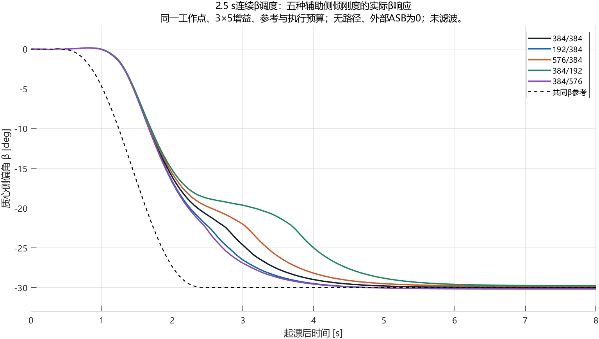
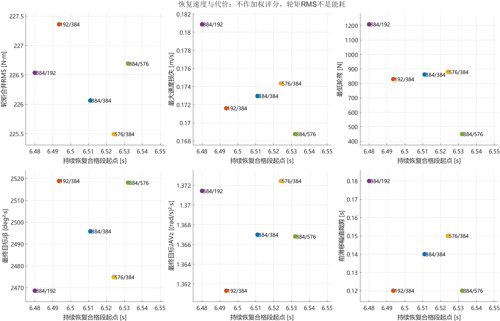

# CarSim–Simulink车辆漂移研究

当前研究文档为 **[V0.4：固定辅助刚度与主动侧倾力矩的漂移对照](docs/v0.4/report.md)**。

核心结论：**起漂阶段的配置差异较大；当前退漂方案的恢复时间接近，但轮荷、轮矩和执行代价不同。起漂最快的配置，不是当前退漂最快的配置。**

研究包含两类对照：固定内部Auxiliary Roll系数时外部ASB为零；新增主动试验则固定内部384/384，在起漂短窗口给单轴±250 N·m。后者支持前正、后负的局部起漂收益及代价取舍，尚未证明ASB状态反馈控制或全过程收益。

## 五配置结果

起漂引用原V0.4的Step35f/g，退漂引用Step35m并由Step35n复核。两批退出调度不同，但新批各组退漂前共同通道与原记录逐样本一致；不能把新退出数据说成原发布那一次运行。

|前/后辅助系数 N·m/deg|起漂时间 s|当前退漂时间 s|退漂最低Fz N|退漂轮矩RMS N·m|
|---|---|---|---|---|
|384/384|3.7625|6.5110|861.55|226.06|
|192/384|3.5420|6.4935|829.89|227.36|
|576/384|4.0575|6.5240|880.04|225.49|
|384/192|4.7650|6.4800|1208.66|226.54|
|384/576|3.4695|6.5320|449.72|226.69|

- **起漂：**后硬384/576最快，后软384/192最慢，耗时极差1.2955 s；β同刻极差峰7.8021°。更快的配置仍有横摆和轮荷取舍。
- **退漂：**后软384/192最快且最低轮荷最高，但掉速和前滑移裁剪更大；前硬576/384轮矩负担最低。恢复极差52 ms，五组均通过，没有整体最优配置。
- **约束：**实际转向限速、前滑移裁剪的先后排序不同。无轮矩保护或轮速预算投影；本轮没有测出加急失败边界。

[综合报告：控制方法、证据与结论](docs/v0.4/report.md) · [起漂—退漂并列表](docs/v0.4/entry_exit_summary.csv) · [退漂专项报告](docs/v0.4/exit_closure/report.md)

## 主动起漂补充：内部384/384保持

起漂后1.5—2.0 s分别给单轴±250 N·m，原车辆闭环全程工作。五组均通过，未改变原控制器或执行预算。

|主动输入|起漂耗时 s|相对零输入|与旧固定刚度的同方向代表，非数值等价|
|---|---:|---:|---|
|零输入|3.7625|基准|384/384|
|前＋250 N·m|3.7155|提前47 ms|前软192/384|
|前−250 N·m|3.8140|延后51.5 ms|前硬576/384|
|后＋250 N·m|3.8555|延后93 ms|后软384/192|
|后−250 N·m|3.6825|提前80 ms|后硬384/576|

**四个方向与旧起漂结论一致，但±250 N·m不能直接等同192/576 N·m/deg。**当前侧倾方向下，正力矩抵消部分恢复作用，负力矩加强恢复作用；固定刚度则随姿态持续产生力矩。

后负起漂提前约2.13%，8 s速度/β误差积分下降8.50%/5.45%，但AVz积分增加2.06%、本窗最低轮荷降低72.05 N。没有一组被证明全面占优；主动退漂方向尚未验证。

[方向与单位解释](docs/v0.4/report.md#7-主动介入补充方向与固定刚度试验是否一致) · [主动专项报告](docs/v0.4/active_entry/report.md) · [五组总表](docs/v0.4/active_entry/summary.csv)

## 控制与任务

普通直行→起漂→固定10 s维持→退漂→自然方向直行；目标V=12 m/s、β=−30°、车体AVz约0.59898 rad/s，无路径要求。五状态反馈[V,β,AVz,κf,κr]产生转向及前后滑移请求，公共执行保留Fx补偿、轮惯量、限速、轮速与±3000 N·m轮矩预算。相同控制器允许实际转角和轮矩随状态变化。

V0.4原模型采用2.5 s连续β起漂和原分段退出；补充的Step35m采用7.167 s同步连续七节点退出。**本次只更新文档与证据，原initialize_v04运行入口未改变。** 新退出调度见[退漂证据说明](experiments/v0.4/supplements/exit_closure/README.md)，新增主动脉冲见[主动起漂证据说明](experiments/v0.4/supplements/active_entry/README.md)；原入口不会自动运行主动补充试验。

## 版本与复现入口

|版本|任务|入口|
|---|---|---|
|V0.1|β−10°普通初态起漂与维持|[报告](docs/v0.1/验收报告.md) / [标签](https://github.com/jun1102011/Vehicle-drift-research/tree/drift-entry-hold-v0.1)|
|V0.2|β−10°起漂、维持、退出与直行|[报告](docs/v0.2/验收报告.md) / [标签](https://github.com/jun1102011/Vehicle-drift-research/tree/drift-cycle-v0.2)|
|V0.3|β−10°固定操场双弯路径任务|[报告](docs/v0.3/验收报告.md) / [标签](https://github.com/jun1102011/Vehicle-drift-research/tree/drift-stadium-v0.3)|
|V0.4|β−30°无路径状态任务；固定刚度及主动起漂对照|[综合报告](docs/v0.4/report.md) / [原模型入口](experiments/v0.4/README.md) / [标签](https://github.com/jun1102011/Vehicle-drift-research/tree/V0.4)|

Windows、MATLAB/Simulink R2023a、CarSim2020.0；12输入/76输出，控制0.01 s、CarSim与原生记录0.0005 s。初始化不启动仿真。原始MAT与大体积VS/VSB留本地，Git保留源码、摘要、关键图与SHA索引；完整独立复算需取得相应原始记录。

结论限定于当前CarSim参数与既定悬架外推。表端不是实物机械极限；没有实车验证、多工况鲁棒性或主动ASB闭环收益结论。V0.3与V0.4任务不同，不能直接解释为全面性能升级。发布完整性见MANIFEST.sha256。
