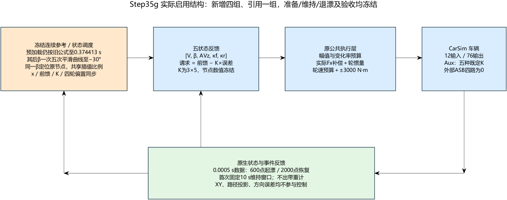

# CarSim–Simulink车辆漂移研究

当前发布 **[V0.4：−30°无路径状态漂移与五刚度对照](docs/v0.4/report.md)**。本版固定连续β参考、五状态控制器及执行预算，只比较五种内部Auxiliary Roll辅助刚度。五组均能完成起漂、固定10 s维持和退漂恢复，起漂瞬态存在明显差异与代价取舍。

**V0.4研究的是状态任务；V0.3的固定操场路径任务继续保留。两版目标与协议不同，不能直接解释为V0.4全面优于V0.3。**

## 当前结果与研究判断

目标V=12 m/s、β=−30°、车体AVz=0.5989797412715093 rad/s。起漂参考2.5 s，−10°/−15°作为连续经过的调度节点，状态、转向/滑移前馈、3×5增益与轮矩偏置同步。外部ASB四路零，普通GUI初态，无路径反馈。

|前/后辅助刚度[N·m/deg]|结果|联合起漂耗时[s]|起漂8 s最低V[m/s]|全程最低Fz[N]|
|---|---|---:|---:|---:|
|384/384|PASS|3.7625|10.728|973.07|
|192/384|PASS|3.5420|10.831|974.81|
|576/384|PASS|4.0575|10.623|992.17|
|384/192|PASS|4.7650|10.495|1435.53|
|384/576|PASS|3.4695|10.865|615.93|

符合“同一参考下辨别刚度响应差异”的预期：起漂耗时极差1.2955 s，β同刻极差峰7.8021°，主要在约−15°后分离。但最快后硬组最低轮荷也最低，前软/后硬的AVz过程误差并非全部改善；固定配置优劣不能称为主动ASB控制有效。总辅助刚度与前后分配仍耦合。

[完整实验报告与限制](docs/v0.4/report.md) · [五配置总表](docs/v0.4/summary.csv) · [模型及运行入口](experiments/v0.4/README.md)

## 实际控制结构

阶段/工作点参考→五状态局部反馈[V,β,AVz,κf,κr]→前轮角/前后滑移请求→公共执行→CarSim。公共执行保留实测Fx负载补偿、轮惯量、转向/滑移限速、轮速及±3000 N·m轮矩预算。Roll/AVx保留物理/日志/接管判断，未回到七项连续反馈。当前轮矩主执行没有显式按新Fz比例分配轮矩；真实轮荷和轮胎响应来自CarSim。Fiala反演不在成功执行主链。

## 版本与入口

|版本|研究任务|入口|
|---|---|---|
|V0.1|β−10°普通初态起漂与维持|[标签](https://github.com/jun1102011/Vehicle-drift-research/tree/drift-entry-hold-v0.1) / [报告](docs/v0.1/验收报告.md)|
|V0.2|β−10°起漂、维持、退出与直行|[标签](https://github.com/jun1102011/Vehicle-drift-research/tree/drift-cycle-v0.2) / [报告](docs/v0.2/验收报告.md)|
|V0.3|β−10°固定操场双弯|[标签](https://github.com/jun1102011/Vehicle-drift-research/tree/drift-stadium-v0.3) / [报告](docs/v0.3/验收报告.md)|
|V0.4|β−30°无路径状态循环、连续参考、五刚度对照|[标签](https://github.com/jun1102011/Vehicle-drift-research/tree/V0.4) / [报告](docs/v0.4/report.md)|

根目录`model/config/validation`保留V0.1—V0.3工程。V0.4独立放在`experiments/v0.4`，不覆盖旧工程；从该目录README进入。Windows、MATLAB/Simulink R2023a、CarSim2020.0，12输入/76输出；控制0.01 s、CarSim/原生记录0.0005 s。初始化不启动仿真，运行需要有效许可、批准配置与独立输出路径。

## 验收与证据范围

起漂V/β/AVz误差≤0.2 m/s、2°、0.03 rad/s且AVz>0，连续600原生样本；首次固定10 s以20000点全窗RMSE验收；退漂后V±0.2、|β|≤1°、|AVz|≤0.02，连续2000点。维持轮矩保护≤5%、最长≤0.2 s，四轮轮荷为正。自然半径/轨迹记录，但不参与本版PASS。

所有结论仅限当前CarSim参数和既定外推模型。后右弹簧查询仍明显超原表域，未扩表、未证明实物组件范围；本版没有扰动鲁棒性、右转、多速度半径或车辆绝对能力边界结论。

每组唯一无损原始数据留本地；Git发布摘要、源码、冻结参数、必要小型证据与关键图，不重复上传大MAT/VSB。[原始数据索引](experiments/v0.4/evidence/raw_data_index.json)提供位置、SHA和分辨率，完整独立复算需取得原始数据。所有发布文件见MANIFEST.sha256。
