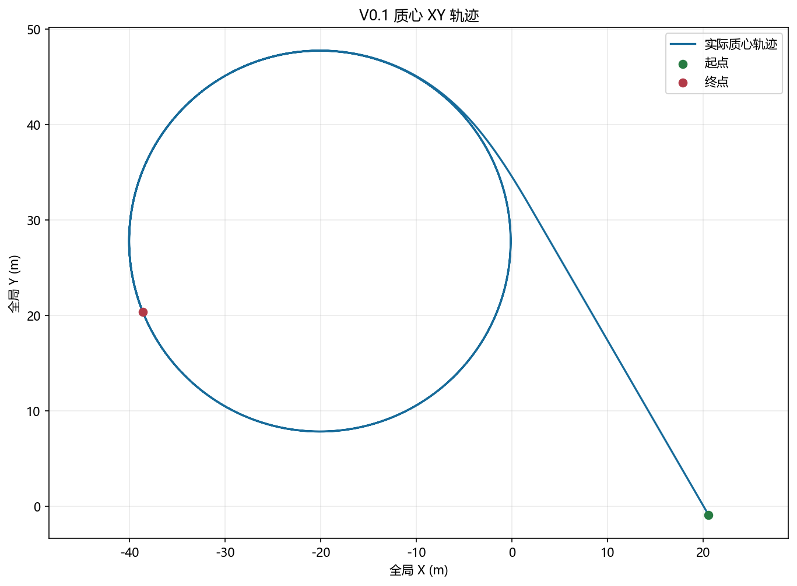
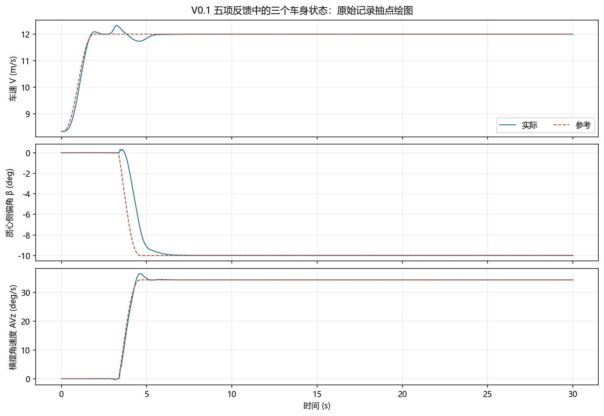

# V0.1｜从普通直行到稳定漂移

本版验证车辆能否从CarSim普通初态连续进入已配平的漂移工作点，并由局部反馈维持。**30 s联合仿真中，车辆于5.67 s完成漂移接管，末5 s状态跟踪通过验收，实际圆拟合半径约19.952 m。**

本项目通过CarSim–Simulink漂移动力学仿真平台，逐步验证车辆状态控制与路径跟踪方法。V0.1是后续进退漂和固定路线实验的内环基线。

## 实验设计与本版工作

车辆从约8.333 m/s的普通直行初态出发，先达到12 m/s准备条件，沿25 m入漂参考调度工作点，满足实际状态接管条件后平滑切入局部维持。全程不恢复漂移配平快照。

| 项目 | 设置 |
|---|---|
| 阶段 | 普通准备 → 入漂调度 → 接管过渡 → 漂移维持 |
| 漂移目标 | V=12 m/s（43.2 km/h）、β=−10°、AVz=0.6 rad/s |
| 名义稳态半径 | V/AVz=20 m；另用实际质心轨迹圆拟合检查 |
| 本版验证对象 | 普通初态可达性、状态建立、局部维持及执行余量 |
| 路径控制 | 关闭；记录轨迹，不指定路径 |

本版采用离线工作点与局部反馈调度、实际四轮轮荷分配和公共轮速执行层。重点是判断“能否到达并维持”，而不只看一次侧偏峰值或动画甩尾。

## 控制方法

控制由**阶段与工作点调度 → 五状态局部反馈 → 转角/滑移请求 → 公共执行层 → CarSim车辆**组成。

- 连续反馈：车速 `V`、质心侧偏角 `β`、横摆角速度 `AVz`、前轴平均滑移率 `κf`、后轴平均滑移率 `κr`，增益矩阵为 `3×5`。
- 反馈输出：前轮目标角、前后轴目标滑移率；前轮采用左右相同转角的平行转向假设。
- 执行层：根据实际接地点速度生成轮速目标，使用实际纵向轮胎力 `Fx` 补偿负载，并保留轮惯量项、轮速变化约束、完整力矩预算和转向限速。
- 车辆侧：使用当前CarSim查表轮胎、组合滑移、松弛和悬架模型，实际四轮轮荷参与分配。Roll、AVx保留在物理动力学、监测和接管判断中，不进入上述连续增益乘法。

局部反馈增益来自局部模型的设计。它与原路径LQR是两个控制层；原路径LQR和式4.10路径项在本次验收中关闭。当前成功执行支路直接控制转角和滑移率，不由Fiala轮胎反演驱动。


## 实验曲线



轨迹由状态跟踪自然形成，没有预设路径或圆心；状态图检验是否建立并维持负侧偏与正横摆。



状态图给出实际与参考车速、侧偏角和横摆角速度；稳态判定使用下面明确列出的窗口，不把进退漂过渡计入稳态误差。

## 实验结果

| 阶段事件 | 时间 |
|---|---:|
| 开始入漂 | 2.62 s |
| 开始接管过渡 | 5.18 s |
| 完成漂移接管 | 5.67 s |

漂移维持验收窗口为 **25.00—30.00 s**，三项误差均以原始时间序列计算。

| 验收量 | 本次结果 | 工程门槛 |
|---|---:|---:|
| 车速RMSE | 0.000580 m/s | ≤0.2 m/s |
| 侧偏角RMSE | 0.01543° | ≤2° |
| 横摆角速度RMSE | 0.0001052 rad/s | ≤0.03 rad/s |
| 实际圆拟合半径 | 19.952 m | 作为实际工作点记录 |
| 最终力矩保护 | 未触发 | 不允许持续激活 |

入漂阶段最低车速为11.730 m/s，全程轮矩绝对峰值1270.7 N·m。本次结果支持该车辆在此初值与工况下能够起漂并维持；V0.1尚不提供退出漂移或指定路径跟踪结论。

## 如何查看与复现

先看本页的轨迹、状态曲线和结果表，再查[完整验收报告](docs/v0.1/验收报告.md)、[指标JSON](validation/v0.1/version_metrics.json)和[原始MAT](validation/v0.1/raw.mat)。指标由未平滑原始数据计算；图片仅按0.01 s间隔取点显示。

原机验收环境为Windows、MATLAB/Simulink R2023a、CarSim2020.0。先使CarSim当前GUI数据集就绪，再在MATLAB中切到仓库的 `model` 目录执行：

```matlab
repair_run_mode = 'drift_entry';
asb_case = 'baseline';
a001_new_Design_LQR_Controller;
open_system('stabilizer_bar_repair');
out = sim('stabilizer_bar_repair','StopTime',num2str(t_final));
```

本版运行30 s，控制周期0.01 s，车辆及转向执行周期0.0005 s。初始化脚本只准备参数，`sim` 才启动车辆。接口为12输入/76输出；本次 `baseline` 的四路附加悬架力为零。仓库含原机绝对路径与配置快照，尚未验证下载后在其他机器直接运行。详细设置见[运行说明](docs/运行说明.md)。

`model/` 保存核心模型、唯一初始化入口和冻结工作点；`config/` 保存CarSim配置快照；`docs/` 保存报告与图；`validation/` 保存原始数据、运行日志与验收指标。文件哈希见 `MANIFEST.sha256`，`.gitattributes` 保留原样字节。

## 结果边界与下一步

弹簧等查表外推警告完整保留，未扩表，表外响应不解释为表内物理验证。本次是固定车辆、路面和初态的一次基线运行，不证明其他速度、半径或扰动均可恢复。

下一阶段是验证能否从此漂移点退出并恢复普通直行，对应[V0.2](https://github.com/jun1102011/Vehicle-drift-research/tree/drift-cycle-v0.2)。
