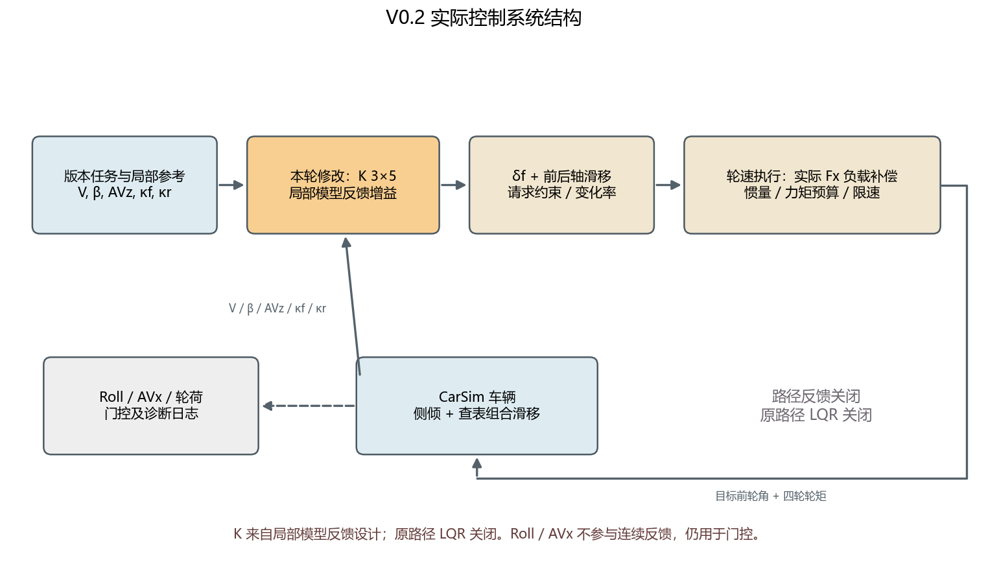
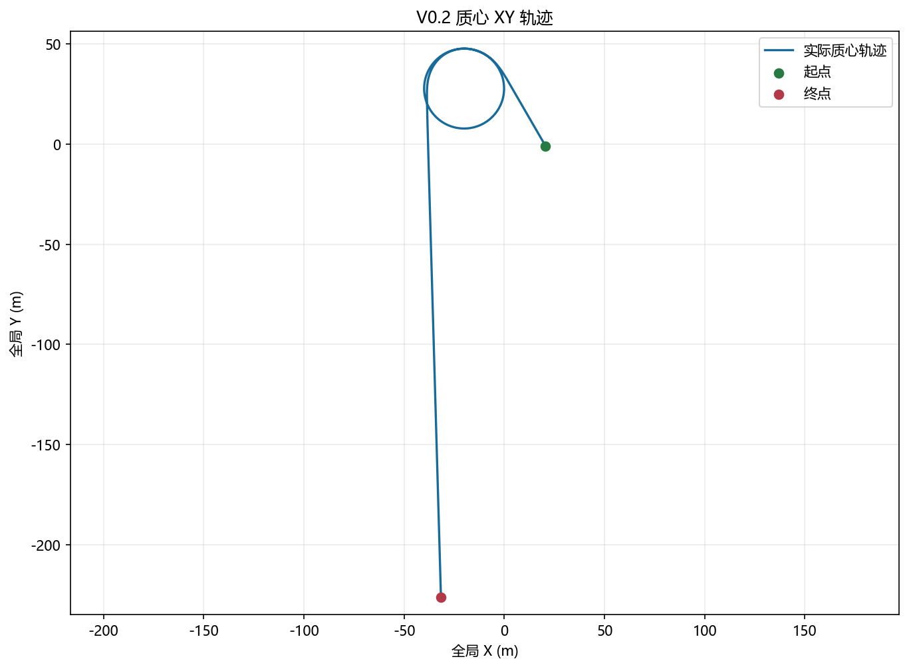
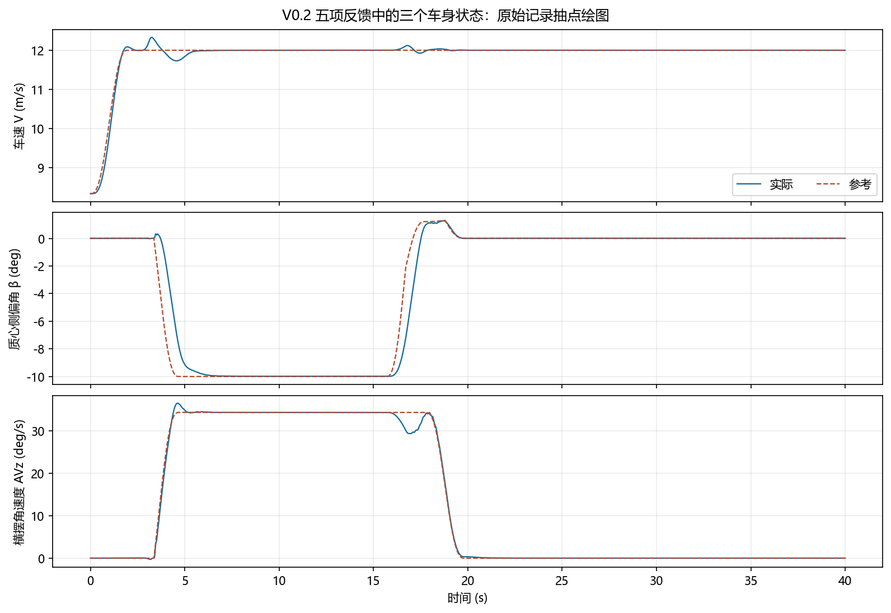

# V0.2｜起漂、维持、退出与直行恢复

本版在V0.1已验证的起漂与维持基础上，增加退出工作点调度和直行接管。**40 s联合仿真连续完成起漂→稳定漂移→退出→直行；15.67 s开始退出，20.61 s完成直行接管，末5 s直行状态通过验收。**

本版回答“车辆能否连续离开漂移工作点并恢复直行”，尚不规定退出后的直线位置或最终航向。

## 实验设计与相对V0.1的变化

保留25 m起漂过程和已验证漂移终点，接管后维持10 s，并确认末5 s状态指标合格后才启动退出。新增的B退出方案先降低高滑移状态、连接普通转弯工作点，再解除转弯并连接12 m/s直行点；总退出调度长度50 m。反馈共用原执行器历史，过程不重置车辆、轮速或转向状态。

| 项目 | 设置 |
|---|---|
| 阶段 | 普通准备 → 起漂 → 漂移接管 → 稳定维持 → 退出调度 → 直行接管 → 直行保持 |
| 漂移目标 | V=12 m/s、β=−10°、AVz=0.6 rad/s |
| 退出终点 | V=12 m/s、β=0°、AVz=0 |
| 相对V0.1新增 | 退出工作点与反馈调度、无突变接管、直行恢复验收 |
| 路径控制 | 关闭；退出后沿自然形成的方向直行 |

## 控制方法

控制由**阶段与工作点调度 → 五状态局部反馈 → 转角/滑移请求 → 公共执行层 → CarSim车辆**组成。

- 连续反馈：车速 `V`、质心侧偏角 `β`、横摆角速度 `AVz`、前轴平均滑移率 `κf`、后轴平均滑移率 `κr`，增益矩阵为 `3×5`。
- 反馈输出：前轮目标角、前后轴目标滑移率；前轮采用左右相同转角的平行转向假设。
- 执行层：根据实际接地点速度生成轮速目标，使用实际纵向轮胎力 `Fx` 补偿负载，并保留轮惯量项、轮速变化约束、完整力矩预算和转向限速。
- 车辆侧：使用当前CarSim查表轮胎、组合滑移、松弛和悬架模型，实际四轮轮荷参与分配。Roll、AVx保留在物理动力学、监测和接管判断中，不进入上述连续增益乘法。

局部反馈增益来自局部模型的设计。它与原路径LQR是两个控制层；原路径LQR和式4.10路径项在本次验收中关闭。当前成功执行支路直接控制转角和滑移率，不由Fiala轮胎反演驱动。



## 实验曲线



轨迹用于观察起漂、维持和退回直行后的运动方向；本版不要求回到指定直线、终点或航向。



状态图给出实际与参考车速、侧偏角和横摆角速度；稳态判定使用下面明确列出的窗口，不把进退漂过渡计入稳态误差。

## 实验结果

| 阶段事件 | 时间 |
|---|---:|
| 完成漂移接管 | 5.67 s |
| 开始退出 | 15.67 s |
| 完成直行接管 | 20.61 s |
| 退出开始至直行接管 | 4.94 s |

漂移验收窗口为 **10.67—15.67 s**，退出后直行窗口为 **35.00—40.00 s**。

| 误差量 | 漂移维持RMSE | 漂移门槛 | 退出后直行RMSE | 直行门槛 |
|---|---:|---:|---:|---:|
| 车速 | 0.000580 m/s | ≤0.2 m/s | 0.00000174 m/s | ≤0.2 m/s |
| 侧偏角 | 0.01543° | ≤2° | 0.00504° | ≤1° |
| 横摆角速度 | 0.0001051 rad/s | ≤0.03 rad/s | 0.00001241 rad/s | ≤0.02 rad/s |

退出阶段车速峰值12.121 m/s，后轴滑移率峰值0.149；全程最终力矩保护未触发。漂移捕获与直行捕获均未回退。本次支持完整状态过程连续完成，不能据此声称车辆回到了指定道路或航向。

## 如何查看与复现

先看本页的轨迹、状态曲线和结果表，再查[完整验收报告](docs/v0.2/验收报告.md)、[指标JSON](validation/v0.2/version_metrics.json)和[原始MAT](validation/v0.2/raw.mat)。指标由未平滑原始数据计算；图片仅按0.01 s间隔取点显示。

原机验收环境为Windows、MATLAB/Simulink R2023a、CarSim2020.0。先使CarSim当前GUI数据集就绪，再在MATLAB中切到仓库的 `model` 目录执行：

```matlab
repair_run_mode = 'drift_cycle';
asb_case = 'baseline';
a001_new_Design_LQR_Controller;
open_system('stabilizer_bar_repair');
out = sim('stabilizer_bar_repair','StopTime',num2str(t_final));
```

本版运行40 s，控制周期0.01 s，车辆及转向执行周期0.0005 s。初始化脚本只准备参数，`sim` 才启动车辆。接口为12输入/76输出；本次 `baseline` 的四路附加悬架力为零。仓库含原机绝对路径与配置快照，尚未验证下载后在其他机器直接运行。详细设置见[运行说明](docs/运行说明.md)。

`model/` 保存核心模型、唯一初始化入口和冻结工作点；`config/` 保存CarSim配置快照；`docs/` 保存报告与图；`validation/` 保存原始数据、运行日志与验收指标。文件哈希见 `MANIFEST.sha256`，`.gitattributes` 保留原样字节。

## 结果边界与下一步

过渡期间速度存在波动，不能用末端稳态RMSE代表全程误差。CarSim表端外推警告记录后继续，未扩表；当前结论仍限于这套车辆和工况。

下一阶段是把已验证进退漂过程放到仿真前固定的操场路线中，加入小幅位置纠偏并检验两次漂移过弯，对应[V0.3](https://github.com/jun1102011/Vehicle-drift-research/tree/drift-stadium-v0.3)。
