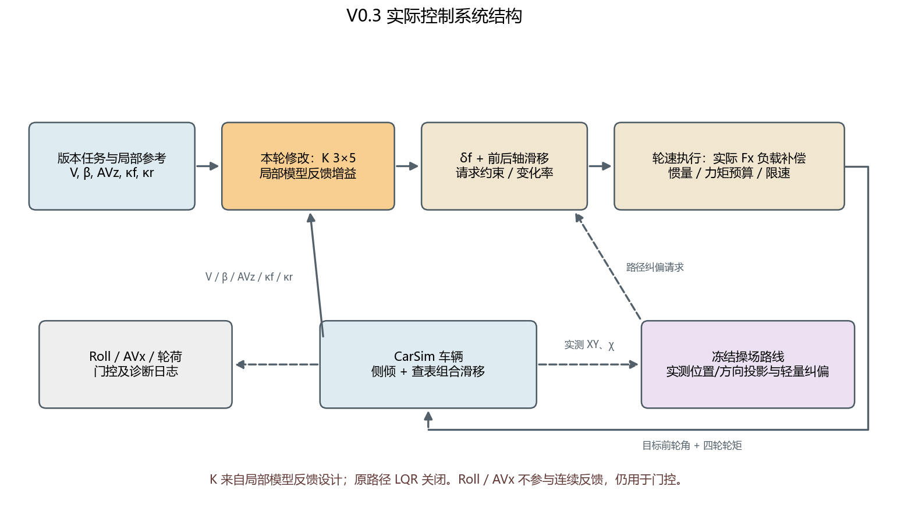
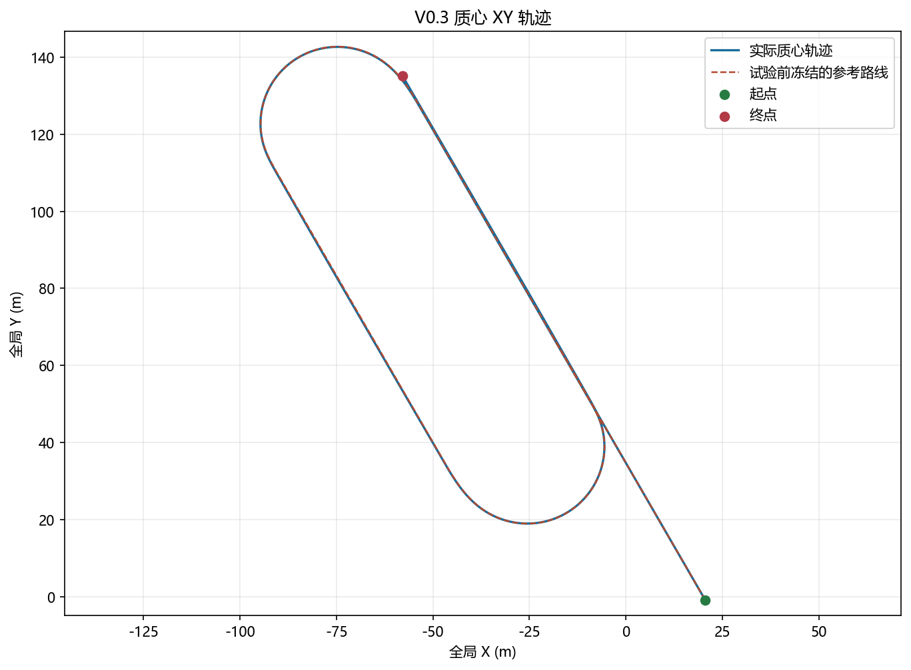
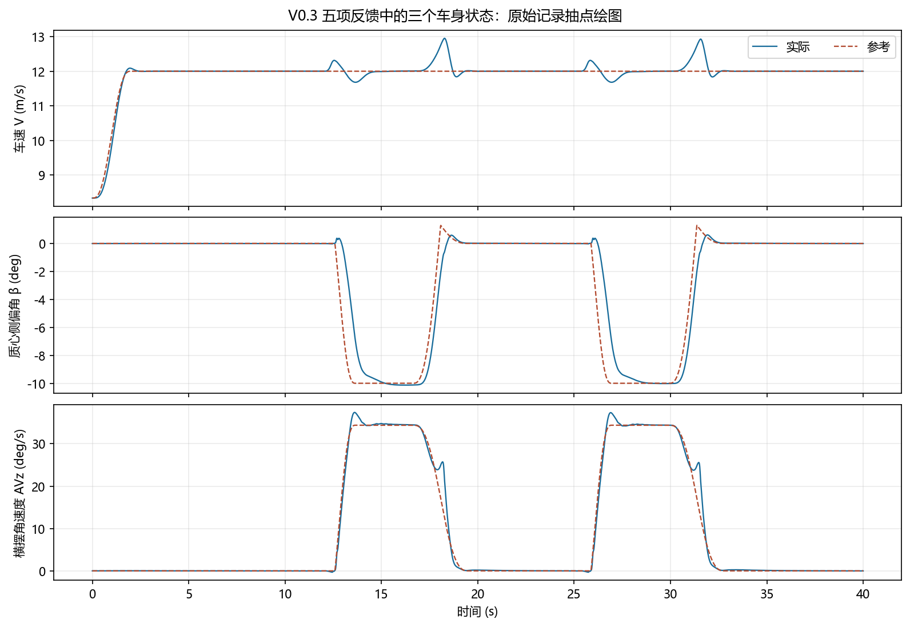
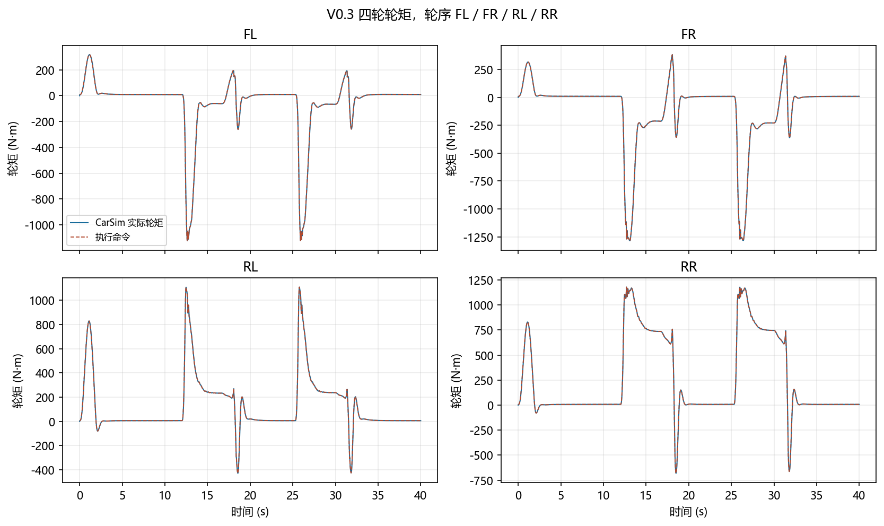
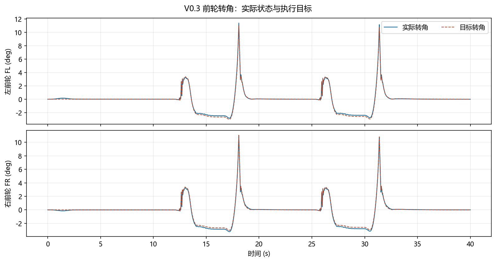

# V0.3 五项反馈验收报告

**本次结论：通过本版预设工况验收。** 40 s 固定两直线、两漂移弯路线；仅启用轻量路径纠偏。判断依据为本版[原始记录](../../validation/v0.3/raw.mat)和[验收指标](../../validation/v0.3/version_metrics.json)，不是控制策略跨工况有效性的证明。

## 工况、输入输出与验收口径

研究问题是五项反馈与同一轮速执行支路能否完成本版指定任务。模型为 CarSim–Simulink 联合仿真，控制周期 0.01 s，车辆及执行记录周期 0.0005 s。三项车身验收状态按 V (m/s)、β (deg)、AVz (rad/s) 统计；稳态参考分别为漂移 `12 / −10 / 0.6`、直行 `12 / 0 / 0`。三项 RMSE 始终按这三个单位顺序列出。前后轴滑移率是连续反馈的另两项，轮荷、Roll、AVx 和轮矩用于约束与诊断。

### 固定空间路线与两弯

参考路线在试验前冻结，含两直线与两漂移弯；从 `model/repair_support/repair_stadium_reference.json` 绘制并叠加在实际质心轨迹上。轻量路径纠偏使用横向位置和行进方向误差修改局部横摆请求，修正限幅 ±0.03 rad/s、变化率 0.06 rad/s²；原路径 LQR 不驱动执行支路。

本版闭合路线验收阈值为横向 RMSE ≤0.5 m、峰值 ≤1 m、闭合位置差 ≤1 m、方向差 ≤3 deg。每弯的维持阶段要求三项 RMSE ≤`0.2 m/s / 2 deg / 0.03 rad/s`、拟合半径相对 20 m 偏差 ≤2%、弧长角 ≥60 deg，并要求起漂状态建立、退出后直行恢复、轮矩保护比例 ≤5%。这些阈值用于这次固定路线评价。

闭合路线区间为 **[7.00, 33.58] s**；引入段不计入闭合路线。完成判定 通过，横向误差 RMSE 0.098 m、峰值 0.204 m；闭合位置差 0.206 m、方向差 0.183 deg。路线切换失败 未发生。

| 弯 | 起漂开始 (s) | 状态进入阈值 (s) | 维持阶段 (s) | 维持 RMSE：m/s / deg / rad/s | 半径 (m) | 弧长角 (deg) | 退出开始 (s) | 直行恢复 (s) |
| ---: | ---: | ---: | ---: | --- | ---: | ---: | ---: | ---: |
| 1 | 12.00 | 14.014 | 1.84 | 0.0060 / 0.1126 / 0.0039 | 19.913 | 63.43 | 16.64 | 20.29 |
| 2 | 25.29 | 27.304 | 1.84 | 0.0068 / 0.0876 / 0.0020 | 19.962 | 63.26 | 29.94 | 33.58 |

两弯维持阶段的实际窗口依次为 **[14.80, 16.64) s、[28.10, 29.94) s**，各 **1.84 s**，是固定空间任务中的短窗口，**不能称为长时间稳态漂移**。两弯来自同一次路线运行，也不能当作两次独立重复。直线 1/2 的状态 RMSE 分别为 `0.0000 / 0.0007 / 0.0001` 与 `0.0000 / 0.0039 / 0.0005`，单位同上；分别通过本版直线阈值。两弯的阶段与路线判定均为 **通过**，仅限这条冻结路线。

## 控制系统与数据边界

[矢量图](figures/00_系统结构.svg) · [可编辑 Mermaid 源](figures/00_系统结构.mmd)

控制器的连续误差反馈是 `K ∈ R^(3×5)`，五项依次为车速 V (m/s)、质心侧偏角 β (rad)、横摆角速度 AVz (rad/s)、前轴平均滑移率 κf、后轴平均滑移率 κr。增益来自局部模型的状态反馈设计，**不是已关闭的路径 LQR**。输出请求为前轮角 (rad) 和前后轴滑移率 (无量纲)。本轮将 Roll 和 AVx 从连续反馈乘法中移除；它们仍是车辆状态、记录量和接管门控诊断量。**五项反馈不等于五状态车辆模型。**

公共执行支路根据实际接地点速度生成目标轮速，含实测纵向轮胎力 Fx 的负载补偿、轮惯量项、力矩预算、轮速加速度限制及请求变化率限制；输出为前轮目标角与 FL/FR/RL/RR 四轮轮矩。CarSim 车辆保留侧倾、轮荷转移与查表的组合滑移轮胎。此执行支路不调用 Fiala 轮胎反演；原路径 LQR 关闭。V0.3 的轻量路径纠偏另行说明。

## 五状态净化等价复核

本轮清理旧切换和对照支路，冻结 `3×5` 局部反馈矩阵；保留的五项增益数值未更改。根据[五状态净化核验](../../validation/五状态净化核验.json)，V0.1、V0.2、V0.3 三版在净化前后的 `repair_plant_raw`、`repair_actuator_command`、`repair_entry_diag`、`repair_cycle_diag`、`repair_stadium_diag`、`asb_import12` 均逐样本最大绝对差为 **0**。这一结果支持本轮清理没有改变这六组已记录信号；Roll 和 AVx 的物理状态、门控与诊断仍保留，不由该零差结果推断跨工况有效性。

| 全程核查量 | 本次记录 |
| --- | ---: |
| 仿真结束时间 | 40.00 s |
| 有效有限值 / 时间严格递增 / 准备失败 | 通过 / 通过 / 未发生 |
| 车速范围 | 8.333–12.953 m/s |
| 最小轮荷 | 1751.3 N |
| 最大轮矩绝对值 | 1286.1 N·m |
| 轮矩保护最长连续时间 / 占比 | 0.000 s / 0.00% |
| 请求约束占比 / 目标轮速投影占比 | 4.45% / 0.025% |
| 实际前轮转角峰值绝对值 | 11.419 deg |
| 四轮驱动正功 / 负功积分 | 778.9 / -321.8 kJ |
| Roll / AVx 峰值绝对值（诊断） | 4.229 deg / 8.469 deg/s |
| 查表外推警告条数 | 17 |

警告来自 CarSim 表端，原文已保留在[指标记录](../../validation/v0.3/version_metrics.json)；它们没有被解释为自动停机条件，也不能据此宣称表外工况已验证。

## 时序与执行证据

图线只对原始记录每 20 点取一点绘制（原始车辆采样 0.0005 s，绘图间隔 0.01 s），不做平滑；验收指标由未平滑原始记录计算。车速由 Vx、Vy 合成并从 km/h 换成 m/s；β 原始为 deg，参考从 rad 换成 deg；AVz 原始为 deg/s，参考从 rad/s 换成 deg/s。轮序为 FL/FR/RL/RR；前轮角为 deg。

## 证据与适用范围

[原始 MAT](../../validation/v0.3/raw.mat) · [验收指标 JSON](../../validation/v0.3/version_metrics.json)。报告中的数值直接取该版本指标 JSON；图从本版本原始数组生成。当前只证明固定参数、固定初值和给定工况下的记录结果；没有通过参数扫描、扰动重复、轮胎/路面变化和独立实车试验验证普遍性。
