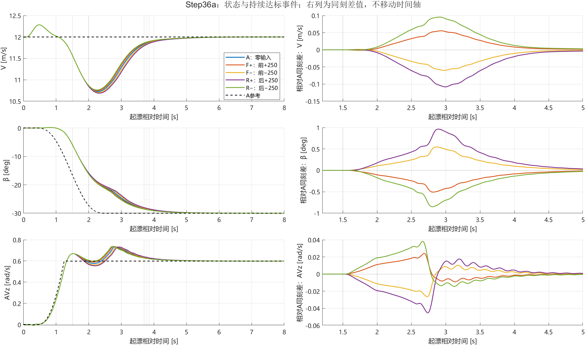
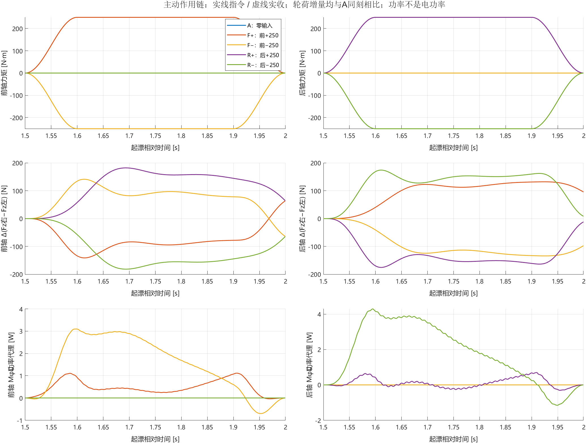
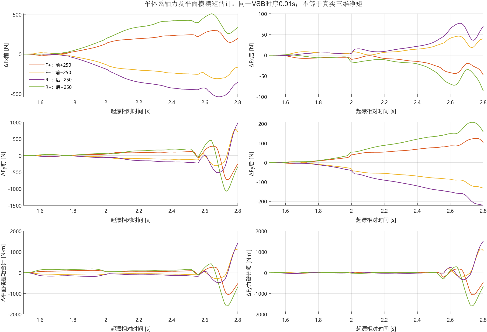
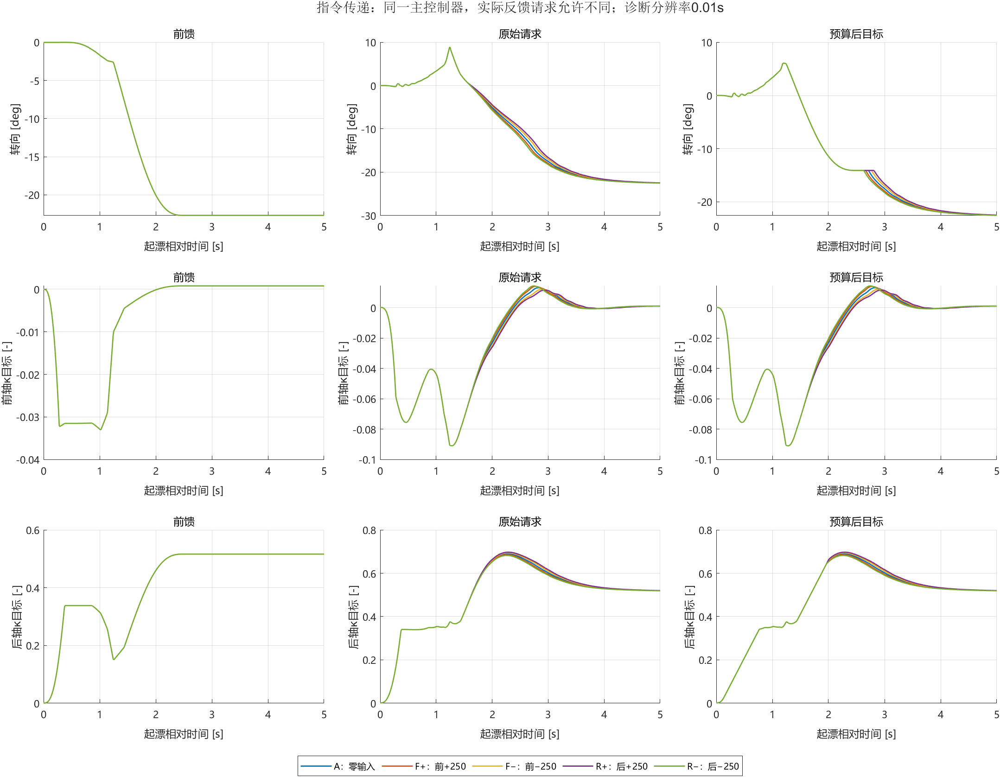
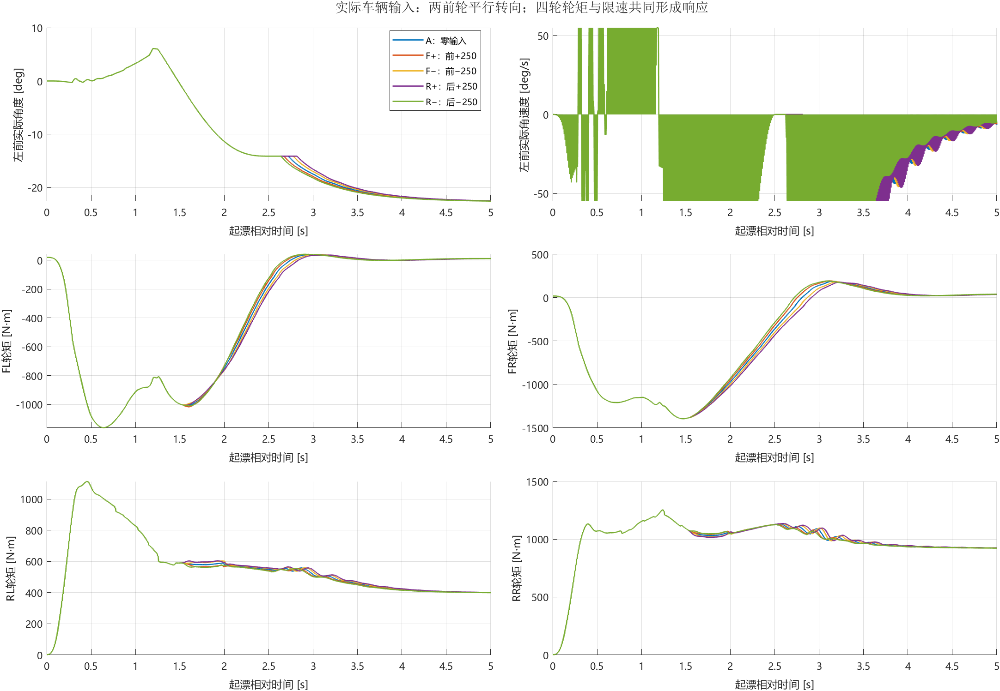
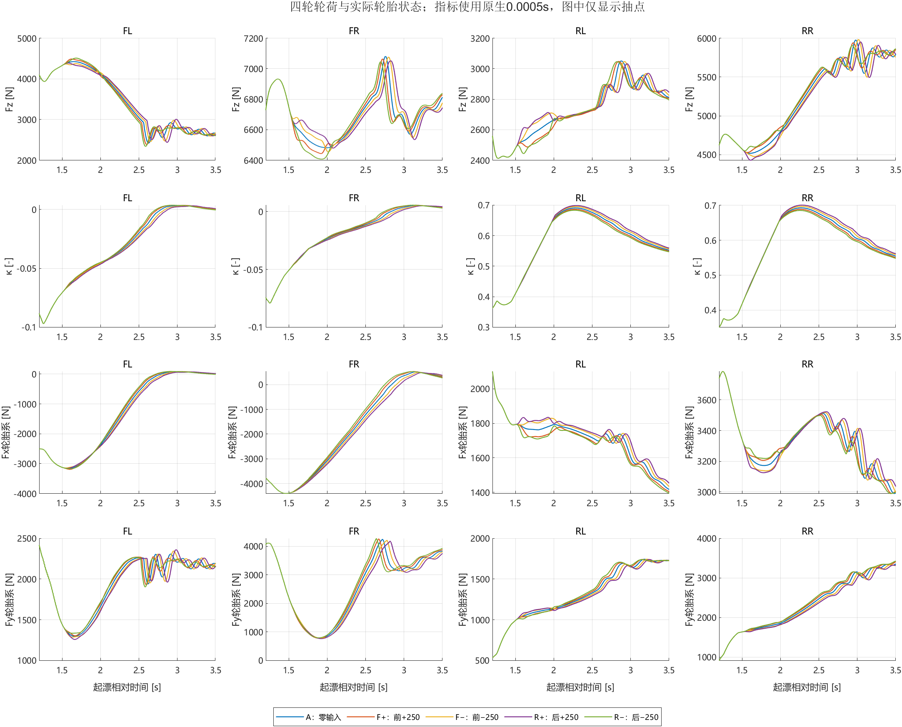
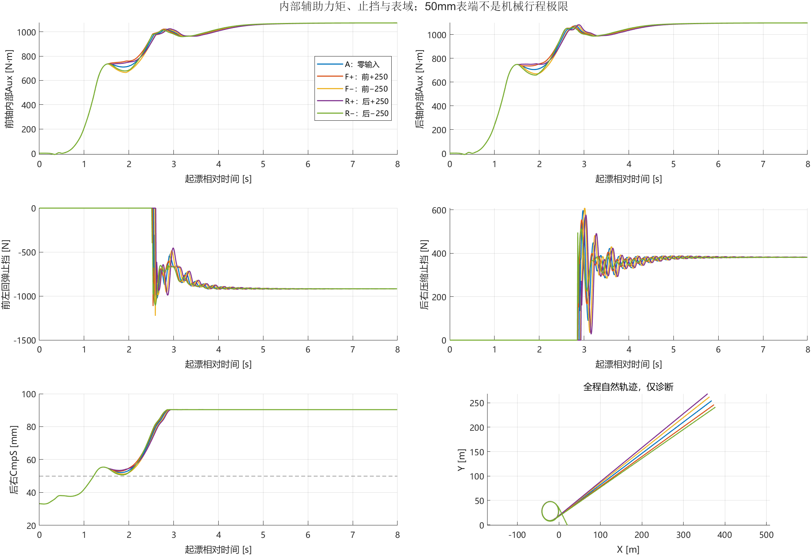
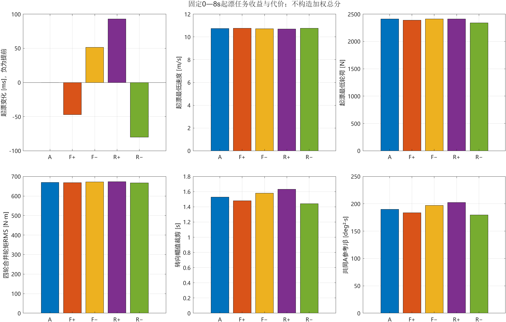
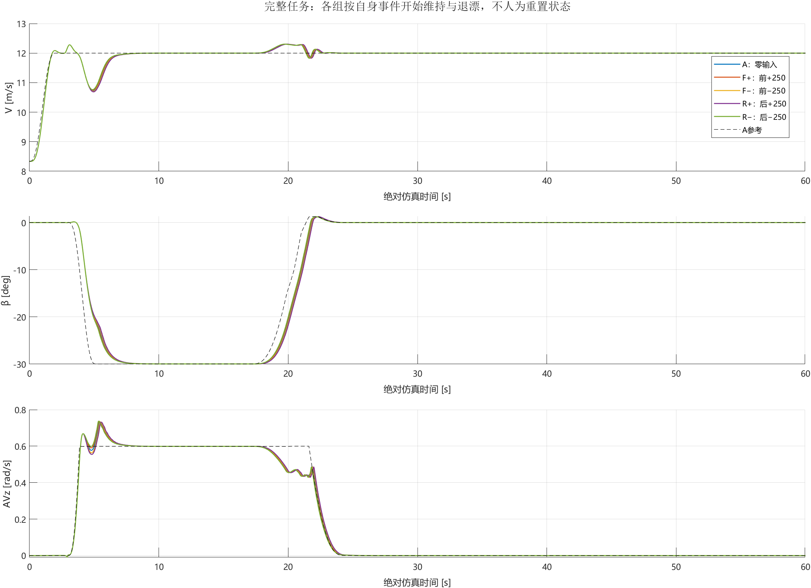
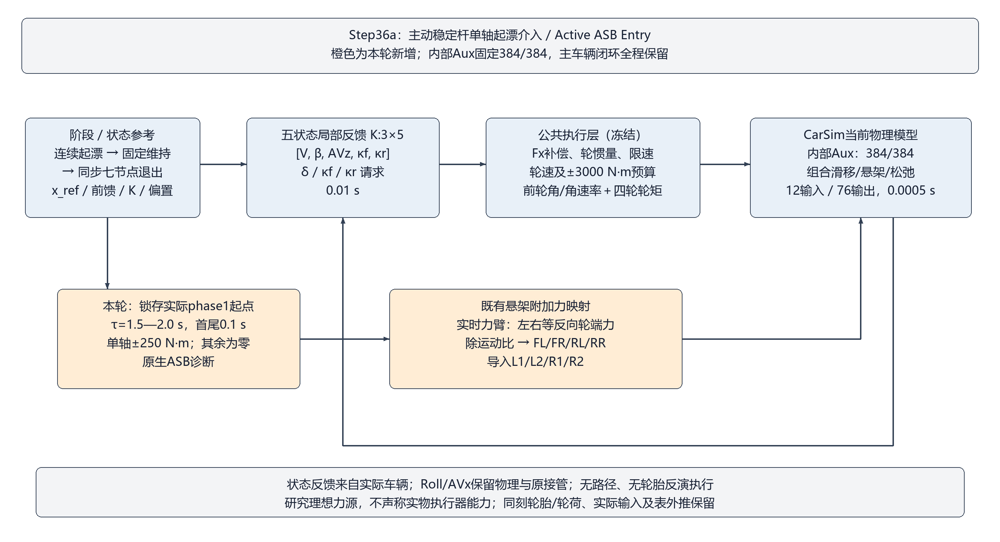

# Step36a：主动稳定杆单轴力矩介入起漂

**日期：2026-10-09｜新增车辆运行5次｜内部辅助刚度统一384/384 N·m/deg｜原主控制器保持。**

## 1. 当前能支持什么结论

本轮已经从“修改固定辅助刚度”转为“在同一辆车上施加外部主动侧倾力矩”。四组分别只给前轴或后轴±250 N·m，作用于起漂后1.5—2.0 s。原五状态车辆闭环全程工作。

按联合起漂事件排序，最快是**R−：后−250**，耗时3.6825 s，相对零输入变化-80.0 ms。各组完整任务判定和代价如下表；更快不自动等于整体更好。判断具体有利方向应同时看共同参考误差、掉速、轮矩与轮荷，不能仅看β偏移大小。

具体判断如下：

- **后轴负向是本批优先候选，前轴正向是另一候选。**R−起漂提前80 ms（约2.13%），F+提前47 ms（约1.25%）；相反方向分别延后93 ms和51.5 ms。五组都完成了原任务，未出现通过/失败分离。
- **收益同时体现在速度与β过程，但横摆和轮荷存在取舍。**R−在固定0—8 s内的共同参考速度、β误差积分分别下降8.50%、5.45%，最低速度提高0.0346 m/s，轮矩RMS降低2.89 N·m；AVz误差积分反而增加2.06%，本窗最低轮荷降低72.05 N。F+的变化方向相近、幅度较小。
- **有主动介入效应，尚无“整体最优”证据。**本批支持在当前窗口继续研究有限的前正/后负辅助方向；不足以直接冻结为全过程ASB反馈控制律。下一轮若另行授权，应优先验证候选方向在相邻状态下是否保持，以及横摆/轮荷代价能否接受，不因曲线分离小而自动加力。

这些是当前窗口、幅值及控制器下的确定性结果。没有做输入重放、其他时机、幅值扫描或扰动鲁棒性测试，不能宣称已经找到ASB最优控制律或普遍有利方向。

## 2. 本轮到底改变了什么

任务：普通GUI直行初态→2.5 s连续起漂参考→首次固定10 s维持→43/6 s同步连续七节点退漂→自然方向直行恢复。目标V=12 m/s、β=−30°、车体AVz=0.5989797412715093 rad/s，V=√(Vx²+Vy²)。无路径要求；不恢复配平快照。

|组别|前轴附加力矩 N·m|后轴附加力矩 N·m|
|---|---:|---:|
|A|0|0|
|F+|+250|0|
|F−|−250|0|
|R+|0|+250|
|R−|0|−250|

以本组第一次phase1为零点，窗口[1.5,2.0) s；首尾各0.10 s半余弦，中间0.30 s平台。阶段只用于锁存起点，干预不会根据其后的β重新择时。各组起漂起点均为2.62 s，因此本批实际窗口为4.12—4.62 s；代码没有把这个绝对时间写成触发条件。

内部Aux系数、车辆/轮胎/悬架/道路、R3的3×5增益、参考/前馈/轮矩偏置、实际Fx补偿、轮惯量、转向与滑移限速、轮速预算、±3000 N·m预算均保持。后轴滑移正向0.4上限没有恢复。维持和退漂没有外部ASB输入。

正力矩按现有接口定义为左正、右负的轮端力偶。每轴q=M/实时有效力臂，左右轮端力为+q/−q，再除以对应运动比得到悬架附加力。CarSim导入顺序仍为L1/L2/R1/R2。**指令力偶不是实际接地轮荷增量，也不能直接将正号解释为“增硬”。**

## 3. 执行真实性与回归证据

- A完成60 s，原56共同通道与Step35m的384/384全程逐位一致，原生起漂、固定维持和恢复事件复现。
- 四个干预组在脉冲开始前的56共同通道与A数值完全一致。负向组ASB诊断与外部零输入包含±0位差，已单独审计；车辆状态、实际八路输入等其余54通道仍逐位一致，原始零符号未改写。每组唯一57通道无损记录，新增1个12项脉冲诊断；原日志含义不变。
- 四个非零组实收悬架附加力相对导入值存在**一个0.0005 s原生步延迟**。按实际时序审计后吻合；没有移动状态时轴。实时力臂也在变化，因此回算实收峰值可能与标称250 N·m有微小差异。
- 每轴附加轮端合力为零；实际Echo内部系数均384/384，内部Aux力矩与相对侧倾角关系核验通过。非目标物理参数文件逐字节相同。
- 18个非脉冲图表、主控制核及工作点profile与Step35m相同。0.01 s控制、0.0005 s车辆/ASB接口保持；无路径扰动和600点事件边界检查通过。

准备过程中一次命令引号解析错误、一次历史空日志的Java哈希异常，均发生在车辆启动前；已修正并保留日志。负向组还曾因上述±0严格位检查停在后处理，独立审计后继续剩余组，原检查日志保留。本批实际车辆次数仍为5，没有重跑或隐藏车辆失败。

|组别|实收力矩绝对峰 N·m|指令速率峰 N·m/s|绝对力矩积分 N·m·s|Mφ̇绝对功率峰 W|Mφ̇绝对功 J|轮端作功代理绝对功 J|
|---|---:|---:|---:|---:|---:|---:|
| A：零输入 | 0.000000 | 0.00 | 0.000 | 0.000 | 0.0000 | 0.0000 |
| F+：前+250 | 250.000049 | 3926.99 | 100.000 | 1.115 | 0.2380 | 0.2377 |
| F−：前−250 | 250.000111 | 3926.99 | 100.000 | 3.096 | 0.7969 | 0.7963 |
| R+：后+250 | 250.000016 | 3926.99 | 100.000 | 0.698 | 0.1079 | 0.1079 |
| R−：后−250 | 250.000154 | 3926.99 | 100.000 | 4.297 | 0.9946 | 0.9930 |

功率及绝对功按[1.5,2.0) s直接作用窗口统计；两种口径分别沿用相对侧倾角速度与轮端垂向速度计算，不假定二者完全相等，不称为真实执行器电功率或能耗。实收端存在一原生步延迟，窗口末尾后的微小撤除尾段保留在原始记录，不移动曲线补入本窗口。250 N·m与约3927 N·m/s只是本批理想力源研究输入，没有据此认证硬件能力。

## 4. 是否更早进入目标漂移

起漂判据保持：V±0.2 m/s、β±2°、AVz±0.03 rad/s且AVz>0，同时连续600个0.0005 s样本。表中耗时为合格段**起点**距起漂开始的时间；确认时刻晚0.2995 s。原生事件另用累计和算法独立复算。

|组别|原任务判定|起漂耗时 s|相对A ms|联合最后限制项|0—8s最低V m/s|0—8s最低Fz N|四轮轮矩合并RMS N·m|转向幅值裁剪 s|
|---|---|---:|---:|---|---:|---:|---:|---:|
| A：零输入 | PASS | 3.7625 | 0.0 | AVz | 10.7280 | 2412.32 | 669.76 | 1.53 |
| F+：前+250 | PASS | 3.7155 | -47.0 | AVz | 10.7481 | 2386.83 | 668.09 | 1.48 |
| F−：前−250 | PASS | 3.8140 | 51.5 | AVz | 10.7061 | 2412.32 | 671.60 | 1.58 |
| R+：后+250 | PASS | 3.8555 | 93.0 | AVz | 10.6884 | 2412.32 | 673.11 | 1.63 |
| R−：后−250 | PASS | 3.6825 | -80.0 | AVz | 10.7626 | 2340.27 | 666.86 | 1.44 |

最低轮荷是各自极值，只用于比较代价；不能拿这一列相减代替同刻调载量。A、F−和R+的本窗最低值均发生在脉冲前τ=1.2745 s的左后轮，因此三个极值相同不表示ASB没有改变轮荷。F+、R−的新最低值则出现在脉冲撤除后的左前轮，分别为τ=2.6000 s、2.5855 s。轮矩RMS按固定8 s内四轮平方均值开方计算，不是能耗。各状态单独达标、确认时刻保存在总表和details。

## 5. 局部变化是否转化成全过程收益

直接作用窗为[1.5,2.0) s、1,000原生点，过程窗为[0,8) s、16,000原生点。两个窗口分别计算，不能把一个窗口的百分比作为另一个窗口的改善。

下表为共同A参考误差平方积分，括号为相对A变化。V、β、AVz单位分别为(m/s)²·s、deg²·s、(rad/s)²·s，不相加成任意总分。自身参考积分另存总表，参考差异逐组审核。

|组别|脉冲JV|脉冲Jβ|脉冲JAVz|8s JV|8s Jβ|8s JAVz|
|---|---:|---:|---:|---:|---:|---:|
| A：零输入 | 0.359217 (+0.00%) | 62.1605 (+0.00%) | 0.000960078 (+0.00%) | 1.8027 (+0.00%) | 190.063 (+0.00%) | 0.0123653 (+0.00%) |
| F+：前+250 | 0.359069 (-0.04%) | 61.7555 (-0.65%) | 0.00102982 (+7.26%) | 1.71443 (-4.90%) | 183.843 (-3.27%) | 0.012475 (+0.89%) |
| F−：前−250 | 0.35933 (+0.03%) | 62.5751 (+0.67%) | 0.000921063 (-4.06%) | 1.9017 (+5.49%) | 196.979 (+3.64%) | 0.0124574 (+0.75%) |
| R+：后+250 | 0.360649 (+0.40%) | 62.7455 (+0.94%) | 0.000895056 (-6.77%) | 1.98617 (+10.18%) | 202.453 (+6.52%) | 0.0126531 (+2.33%) |
| R−：后−250 | 0.357702 (-0.42%) | 61.5938 (-0.91%) | 0.00113058 (+17.76%) | 1.64955 (-8.50%) | 179.706 (-5.45%) | 0.0126204 (+2.06%) |

|组别|脉冲内最大绝对ΔV m/s|最大绝对Δβ deg|最大绝对ΔAVz rad/s|单轮同刻ΔFz绝对峰 N|同刻Δ平面横摆矩RMS N·m|
|---|---:|---:|---:|---:|---:|
| A：零输入 | 0 | 0 | 0 | 0.000 | 0.000 |
| F+：前+250 | 0.004046 | 0.10385 | 0.011095 | 72.317 | 82.868 |
| F−：前−250 | 0.0041357 | 0.10576 | 0.011335 | 73.756 | 84.269 |
| R+：后+250 | 0.0083905 | 0.1757 | 0.019306 | 91.929 | 143.934 |
| R−：后−250 | 0.0084009 | 0.17243 | 0.018918 | 90.770 | 141.562 |

这里有一个关键区别：**R−最终更早完成联合起漂，但其AVz全窗跟踪误差并没有减小。**它改变了横摆响应的时序与幅度，不能把“更早持续入带”写成“横摆全过程更平稳”。反过来，R+虽在脉冲内减小AVz误差积分6.77%，最终起漂却延后93 ms，8 s三项误差积分也都增加。局部跟踪和最终起漂事件必须分别判断。

以上偏移幅值描述作用大小，不代表全部有利。主要状态差异延续到脉冲撤除之后；受力脉冲的0.5 s窗口不能代替完整起漂评价。自身与共同A参考已核对为浮点精度内相同。延迟0.10/0.20/0.30/0.40/0.49 s的状态、共同参考误差、轮胎力、轮荷与平面矩分项见[same_delay_response.csv](same_delay_response.csv)。

车体系轴力采用同一VSB时刻的实际四轮转角旋转Fx/Fy；平面横摆矩为前后Fy力臂项、左右Fx差项及四轮回正矩之和。固定a/b/轮距和平面假设未包含完整三维接地点动力学，因此只能叫平面估计。VSB为0.01 s，不能冒充0.0005 s原生三维净矩。

原反馈在ASB介入后可以改变实际转向和四轮轮矩，这是当前联合闭环响应的一部分。没有同窗重放组，不能从这些变化量得出“反馈抵消百分比”，也不能将全部变化归因于Fx补偿。

## 6. 执行与悬架代价

|组别|前/后滑移幅值裁剪 s|转向/前/后目标限速 s|实际转向速率贴界累计/最长 s|轮速投影/轮矩保护 s|实际轮矩绝对峰 N·m|
|---|---:|---|---:|---:|---:|
| A：零输入 | 0.00/0.00 | 0.00/0.05/1.18 | 0.5765/0.0065 | 0.0000/0.0000 | 1396.93 |
| F+：前+250 | 0.00/0.00 | 0.00/0.05/1.17 | 0.5780/0.0065 | 0.0000/0.0000 | 1396.93 |
| F−：前−250 | 0.00/0.00 | 0.00/0.05/1.19 | 0.5750/0.0065 | 0.0000/0.0000 | 1396.93 |
| R+：后+250 | 0.00/0.00 | 0.00/0.05/1.20 | 0.5745/0.0065 | 0.0000/0.0000 | 1396.93 |
| R−：后−250 | 0.00/0.00 | 0.00/0.05/1.16 | 0.5780/0.0065 | 0.0000/0.0000 | 1396.93 |

控制裁剪按0.01 s诊断，实际转向贴界与轮矩按0.0005 s记录。累计贴界不等于连续饱和；达到正常执行限速不自动判为任务失败。

|组别|0—8s后右弹簧超+50mm最大幅度 mm|累计暴露 s|VSB各止挡最大绝对力 N|全程记录告警条数|
|---|---:|---:|---:|---:|
| A：零输入 | 40.374 | 6.7870 | 1023.87 | 21 |
| F+：前+250 | 40.370 | 6.7870 | 1112.73 | 21 |
| F−：前−250 | 40.375 | 6.7870 | 1223.77 | 21 |
| R+：后+250 | 40.372 | 6.7870 | 990.41 | 21 |
| R−：后−250 | 40.365 | 6.7870 | 1106.47 | 21 |

原表端外推继续存在，幅度与持续时间见表和[suspension_domains.json](suspension_domains.json)。止挡参与、表端外推、非正轮荷与机械安全是不同问题；此处使用用户接受的CarSim参数及既定外推规则，真实部件范围没有因此获得验证。未知查询或仅代理可核对的轮胎表域在审计中保留未知标记，不能以告警条数代替实际域暴露。

## 7. 脉冲撤除后的完整任务

|组别|10s维持V RMSE m/s|β RMSE deg|AVz RMSE rad/s|退漂恢复耗时 s|全程最低Fz N|
|---|---:|---:|---:|---:|---:|
| A：零输入 | 0.008220 | 0.06828 | 0.0015339 | 6.5110 | 861.55 |
| F+：前+250 | 0.008200 | 0.06810 | 0.0015290 | 6.5110 | 861.61 |
| F−：前−250 | 0.008232 | 0.06892 | 0.0015447 | 6.5110 | 861.53 |
| R+：后+250 | 0.008268 | 0.06934 | 0.0015542 | 6.5110 | 861.53 |
| R−：后−250 | 0.008145 | 0.06764 | 0.0015191 | 6.5110 | 861.66 |

维持为首次固定20,000点，不另挑窗口；退漂恢复从各组实际phase4开始独立搜索2,000原生点。不同起漂耗时会改变后续阶段的绝对开始时间，因此全程图按绝对时间显示时曲线可以错开。后段ASB为零不等于前段干预的动态历史被清除。

## 8. 结论边界与复现入口

本批用于筛选局部候选轴与方向。即使某方向起漂更快，也仍需检查过程积分、速度和轮荷取舍；不能把单窗口最优直接作为全过程主动控制律。与之前五固定刚度结果相比，本批的变化量是外部力矩脉冲，两种研究不能按刚度大小直接一一对应。

模型位于本批model，唯一初始化为a001_step36a_initialize.m。internal/execute_batch.m会启动车辆且拒绝覆盖已有组；本批已完成，**不要为重画图再次调用它**。只读复算用internal/analyze_batch.py，绘图用internal/render_figures.m，主报告由internal/write_report.py生成。

原始数据五份共282.93 MiB，仅在results/runs各保留一份raw_numeric.mat及必要CarSim证据。历史原始记录只引用，缓存从原始记录重建；正式工程、历史版本和Git V0.4不改。本批完成后停止，不自动增幅、移窗、组合轴、干预退漂或设计ASB反馈。

## 发布副本说明

本报告数值来自Step36a本机冻结记录；发布时只调整图链接并补充本说明。本仓库不包含原始MAT/VSB，原V0.4运行入口没有切换到本实验。源码与原始数据身份见[证据说明](../../../experiments/v0.4/supplements/active_entry/README.md)。方向与固定刚度的关系另见[综合报告第7节](../report.md#7-主动介入补充方向与固定刚度试验是否一致)。
