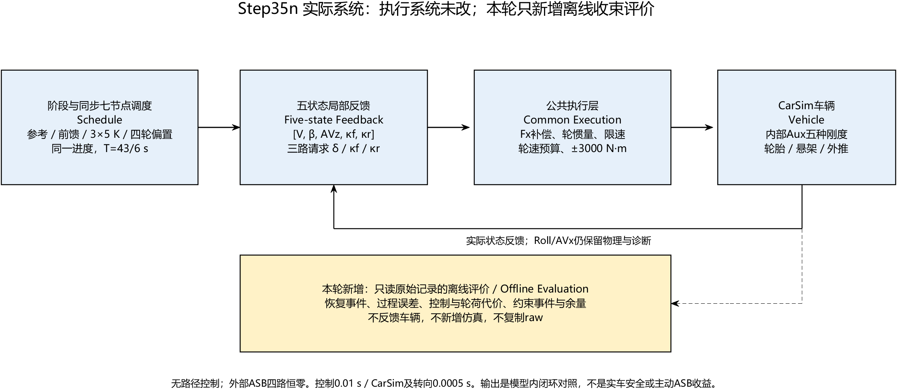
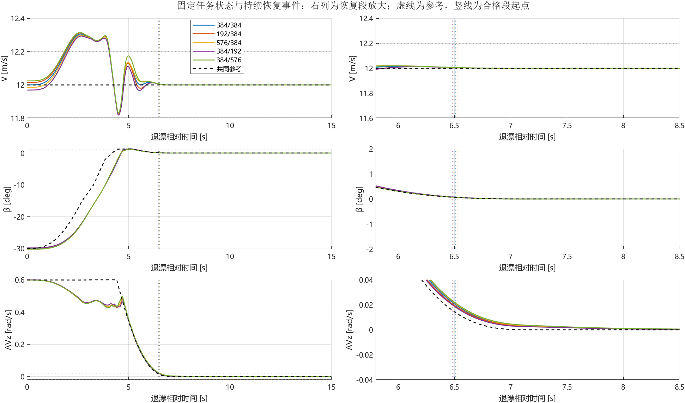
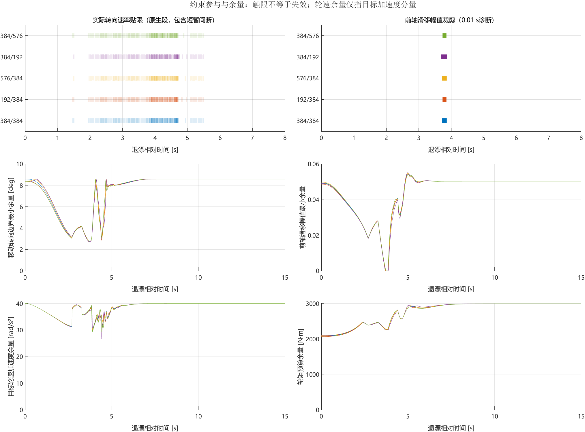
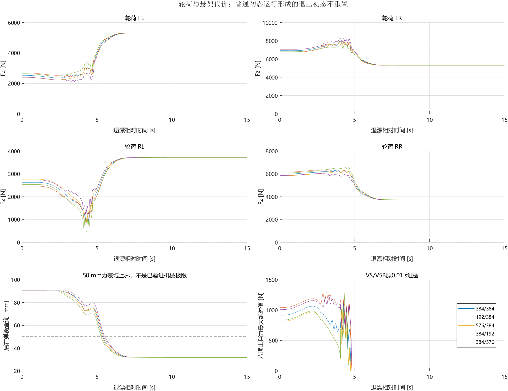
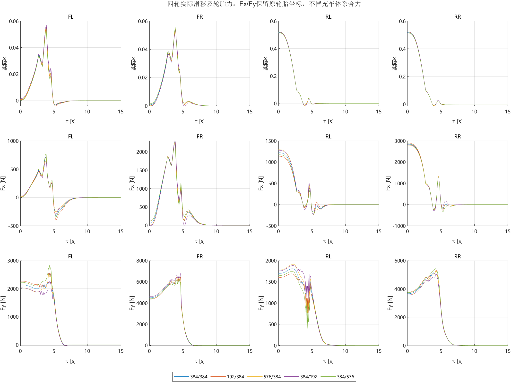
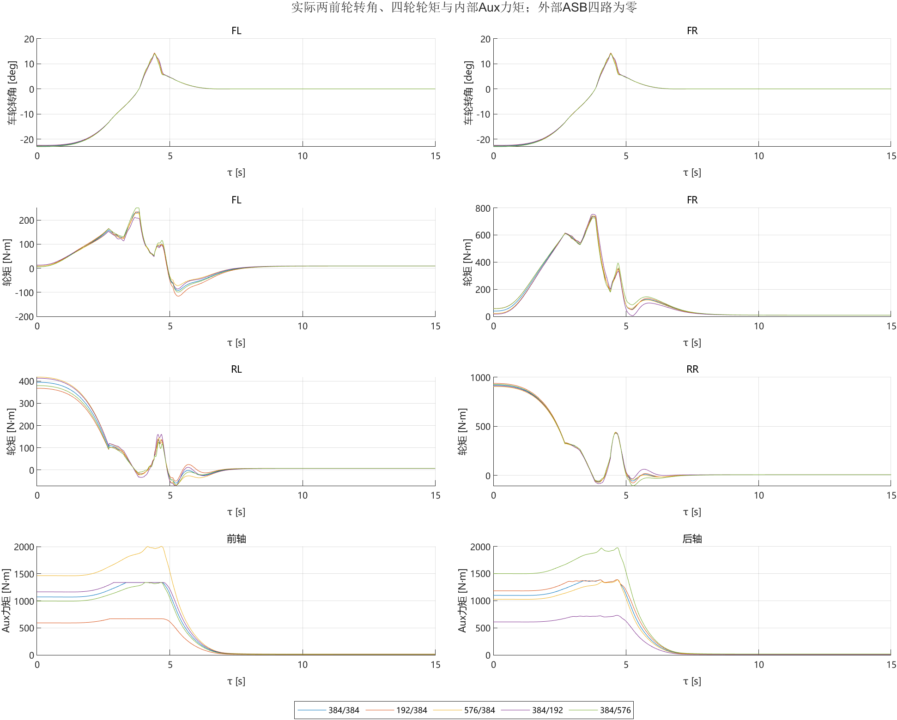

# 退漂对照报告：谁恢复得更好，代价在哪里

**研究批次：Step35m车辆试验 / Step35n离线复核。文档整理：2026-10-09。** 只分析已有五组记录；本次没有新增仿真或改变任何验收标准。

## 1. 先看结论

五种配置都能从−30°漂移恢复直行，没有出现通过与失败的分组。恢复最快与最慢相差52 ms，约0.80%；更值得关注的差异是轮荷、轮矩和执行限制。

- **384/192恢复最快，最低轮荷也最高**，但掉速、β正向偏移和前轴滑移目标裁剪更多。
- **576/384轮矩负担最低**，β相对调度参考的误差积分也最小，但恢复较慢。
- **384/576掉速较小、β正向偏移较小**，但恢复最慢、超速最大、最低轮荷最低。

因此，当前结论是各有取舍，没有一组在恢复、速度、轮荷与控制负担上全面占优。β曲线接近不代表刚度没有影响，也不能为了拉开曲线而把失控当成成功。

## 2. 比较的是哪一种退漂

任务为普通直行初态起步，完成起漂与固定10 s漂移维持，再退出至自然方向直行。漂移目标为V=12 m/s、β=−30°、车体AVz=0.598979741 rad/s；V是平面合速度，不是纵向分量Vx。

五组前/后Auxiliary Roll系数分别为384/384、192/384、576/384、384/192、384/576 N·m/deg。每次运行内部系数固定，外部四路ASB附加力为零。因此本报告评价的是**固定辅助侧倾刚度与同一闭环控制器配合时的表现**，不是主动稳定杆在线控制的收益。

退出参考总长43/6≈7.167 s。保留七个既有节点，以一个全局平滑进度连续经过；参考状态、转向/滑移前馈、3×5反馈增益和四轮轮矩偏置同步推进。内部节点不再人为停顿，但仍存在正β节点和早期较大的AVz目标；这不是单调回零，也不是起漂的逆过程。

五组使用完全相同的调度、反馈增益和执行预算，没有按刚度重新整定。实际转角和轮矩会随反馈变化。退出前状态由各组此前的运动自然形成，不人为重置；所以本轮不是相同完整初态下的孤立物理参数辨识。

## 3. 用什么标准判断“恢复”与“代价”

|对象|统一口径|含义|
|---|---|---|
|恢复时间|从实际开始退漂算起，V=12±0.2 m/s、β绝对值≤1°、AVz绝对值≤0.02 rad/s，同时连续2,000个原生样本|取首个合格段起点；确认时刻另晚0.9995 s，不等于阶段切换时刻|
|过程指标|退漂后固定[0,15) s，共30,000点|不按各组恢复时刻截短，所有组比较相同时长|
|参考误差|相对实际调度参考，以及相对共同最终目标[12,0,0]分别计算|前者描述跟踪，后者描述向直行恢复；不混为一项|
|轮矩负担|固定15 s内四轮平方均值的平方根，同时报告峰值|是控制输入量级，不是能耗|
|轮荷|四轮最小值、车轮及发生时刻；另算同刻基线差值|不同时间的最小值之差不能叫作同刻调载量|
|触限|分别记录首次、累计、最长连续和剩余余量|触限参与不自动等于任务失效|

状态与实收输入按0.0005 s计算；控制裁剪按0.01 s；止挡保留VS/VSB原0.01 s证据。表格中的三种状态积分分别保留单位，不相加成总分。原起漂、维持与执行门槛保持，不用新增指标事后改写PASS。

## 4. 恢复时间差异有限，过程取舍仍然存在

|前/后系数|判定|恢复时间 s|最大掉速 m/s|最大超速 m/s|β正向峰值°|轮矩RMS N·m|最低轮荷 N|
|---|---|---|---|---|---|---|---|
|384/384|PASS|6.5110|0.1730|0.3056|1.2435|226.06|861.55|
|192/384|PASS|6.4935|0.1716|0.3119|1.2365|227.36|829.89|
|576/384|PASS|6.5240|0.1744|0.2992|1.2405|225.49|880.04|
|384/192|PASS|6.4800|0.1809|0.2937|1.3033|226.54|1208.66|
|384/576|PASS|6.5320|0.1688|0.3144|1.1604|226.69|449.72|

五组恢复前最后未达标的量都是AVz；确认恢复后至60 s均没有再次出带。恢复排序为384/192、192/384、384/384、576/384、384/576，从快到慢。

“过程更平稳”不能只用恢复时间回答。共同最终目标下，384/192的速度和β误差积分最低，而192/384的AVz积分最低；相对实际调度参考，384/192的速度和AVz积分最低，576/384的β积分最低。正β峰值同时包含参考安排，不能全部解释为失稳超调。

原PASS也不表示退出全程紧贴参考。例如384/384的β自身参考RMSE为2.671°、峰值误差8.122°，这是退出15 s指标，不能与漂移维持窗口门槛混用。

## 5. 哪组先触限，要按约束种类分别看

|前/后系数|转向速率首次 s|转向贴限累计 s|最长连续 s|前κ幅值裁剪首次 s|前κ裁剪累计 s|轮矩剩余余量 N·m|
|---|---|---|---|---|---|---|
|384/384|1.4600|0.7775|0.0080|3.72|0.14|2080.95|
|192/384|1.4400|0.7905|0.0085|3.73|0.12|2063.62|
|576/384|1.4700|0.7725|0.0075|3.71|0.15|2095.69|
|384/192|1.4800|0.7670|0.0075|3.69|0.18|2089.44|
|384/576|1.4400|0.7775|0.0070|3.73|0.12|2073.88|

192/384与384/576最早触及实际转向速率限制；384/192最晚。但前轴滑移幅值裁剪恰好是384/192最早、持续最久。因此没有一个统一的“最先触限组”，更不能把这张表解释为已找到谁先失控。

实际转向速率峰值均为54.7945°/s。累计贴限约0.77—0.79 s，由多次短片段组成，最长连续仅7—8.5 ms；不能写成持续饱和0.8 s。0.01 s目标限速未参与而0.0005 s车轮执行短暂贴限，在此执行结构下可以同时发生；原生差分和限速公式已经核对。

五组转向幅值裁剪、后轴滑移幅值裁剪、轮速预算投影和轮矩保护均未参与。实际轮矩距±3000 N·m预算仍有约2064—2096 N·m余量；目标轮速联合预算非空，接地点速度与四轮轮荷均为正。后轴正向滑移目标没有有限上界，不编造其上限余量。

这些记录证明部分执行限制参与了过程，但没有隔离证明“限速导致恢复差异”，也没有测试更高任务强度下的失效边界。

## 6. 轮荷与悬架代价不能被接近的β曲线掩盖

384/192左后最低轮荷为1208.66 N，384/576为449.72 N，发生在退漂后4.2590 s和4.3015 s。后者仍为正，但可用轮荷余量明显较小；这不等于已经确认机械不安全。完整同刻轮荷差值与车轮明细见details.json。

所有组退漂开始时，后右弹簧查询已经超出原表上界50 mm；本窗口最大超出约40.34—40.37 mm，累计5.2755—5.5220 s。前左回弹止挡、后右压缩止挡也已经参与。它们不是本次退出新触发的同一类“失败事件”。表端不是经验证的机械行程极限，止挡力也不是接地轮荷。

Fx/Fy保留原轮胎坐标，不能直接相加冒充车体系轴合力。当前CarSim参数及既定外推按已接受的研究范围使用，真实组件有效范围仍未获得实测验证。

## 7. 可以怎样使用本轮结论

同总辅助刚度576的一对中，384/192比192/384恢复早13.5 ms；总和960的一对中，576/384比384/576早8.0 ms。两对均表现为前轴辅助系数占比更高时恢复略快、轮矩RMS略低、最低轮荷较高，但掉速和前滑移裁剪增加。Aux系数之和不等于车辆总侧倾刚度。

因此，当前可以针对具体目标选择候选：重视恢复速度与轮荷时关注384/192，重视轮矩负担时关注576/384。不能省略各自代价，更不能直接把固定配置优劣写成在线主动稳定杆的收益。

本轮未新增加急档位、扰动或不同工况，确定性单次结果不构成统计显著性、鲁棒性或实车极限结论。

## 8. 数据、核验与复现入口

- [五配置总表](summary.csv)：全部状态积分、单轮轮矩、恢复后波动与代价。
- [约束事件表](constraint_events.csv)：每类首次、累计、最长连续、初始参与及余量。
- [详细复核数据](details.json)：实际来源、raw哈希、单状态事件、退出初态、同刻轮荷差、止挡与表域。

五组原始记录与配置哈希、实际K/偏置日志、请求及公共执行公式已核对。恢复事件由两种实现复算一致，冻结的起漂、维持和恢复验收器全部通过；Step35m的378项归档文件保持原SHA。本次只改写文档，不重新仿真或改变指标。原始数据留本机，Git只发布小型证据、总表和关键图；没有原始记录时不能声称可独立完整复算。

离线分析入口为Step35n的internal/analyze_closure.py，实际调度核验为verify_recorded_schedule.py，绘图为render_closure.m；这些入口依赖原机冻结历史目录，不能当作下载即运行的独立程序。结构图可编辑源随绘图脚本保留。
