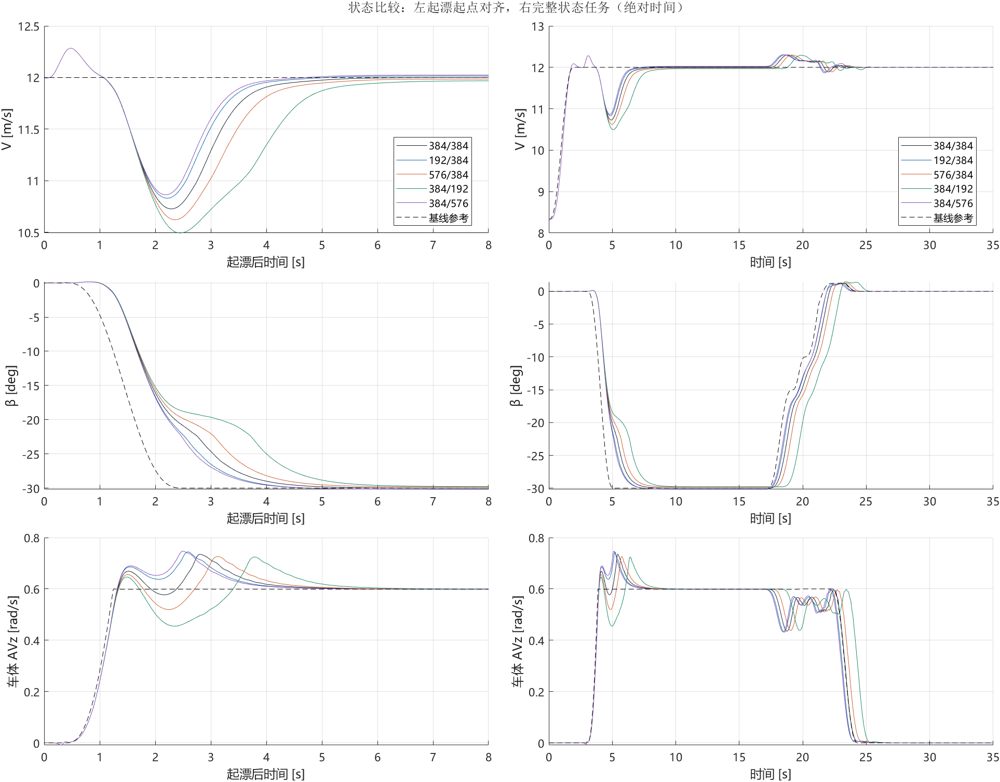
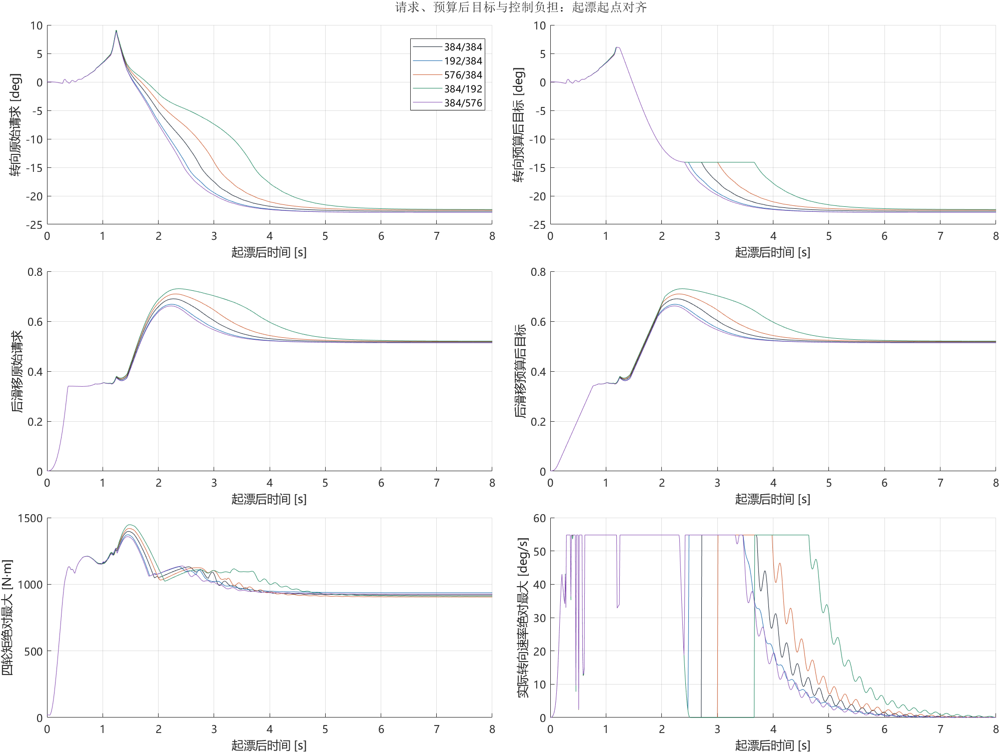
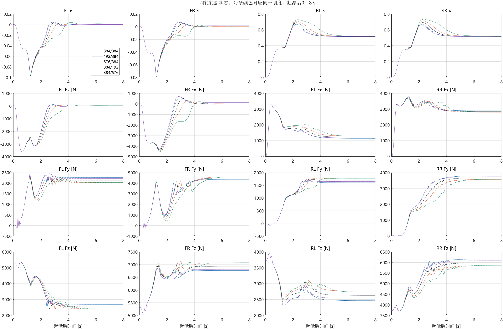
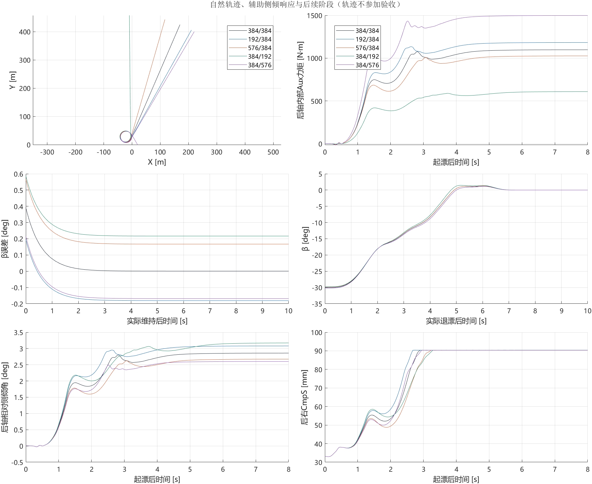

# V0.4实验报告：连续β参考下的−30°状态漂移与五刚度对照

2026-10-07。用户接受Step35f连续β调度后，新增192/384、576/384、384/192、384/576四组，各60 s；384/384引用Step35f唯一原始记录。五组均PASS。没有重新调参、配平、改门槛、改变起漂时长或增加主动ASB。

## 是否符合研究预期

本版回答“相同连续参考、反馈与执行预算下，不同内部辅助侧倾刚度能否呈现可辨别的状态响应差异”。**对此预期，结果支持；对于整体性能提高、普遍最优刚度或主动ASB控制有效，目前不支持作出结论。**

|预期或假设|判断|证据与边界|
|---|---|---|
|连续通过−10°、−15°调度节点，仍能完成−30°状态任务|支持|五组起漂、固定10 s维持和退漂恢复全部PASS；普通GUI初态，无配平快照|
|相同指令下刚度差异能在状态层显现|支持|联合起漂耗时极差1.2955 s；同一时刻β极差峰7.8021°，主要出现在约−15°以后|
|β参考连续后，实际β也必然全程均匀顺畅|不支持|后软384/192仍在约−18°至−20°放缓，参考形状与实际响应必须区分|
|新调度让五种配置全部更快、代价更低|不支持|相对旧同总时长分段参考，仅前软、后硬更快；五组起漂最低速度全部降低|
|后硬组是全过程最优|证据不足|起漂最快，同时全程最低轮荷约616 N、起漂AVz峰值与误差积分更高|
|已经证明主动稳定杆闭环有效或车辆绝对极限|未检验|外部ASB四输入全零；本轮为五种固定内部辅助刚度与同一控制器的对照|

五组辅助总刚度分别768、576、960、576、960 N·m/deg，总量与前后分配耦合。现有结果可以比较具体配置，不能将全部差异单独归因于分配比例；Auxiliary Roll系数也不是整轴悬架总侧倾刚度。重复确定性记录不构成扰动鲁棒性验证。

V0.4采用无路径任务；V0.3是β−10°操场路径任务。目标、参考、反馈工作点和验收对象发生变化，因此不能直接称V0.4全面优于V0.3，也不能用两版对照单独证明“大侧偏必然放大刚度效应”。

下一优先级是用本批已有数据对齐β放缓区间，检查轮胎轴合力、实际滑移、转向请求与裁剪的时间关系；若以后研究纯分配效应，再另行授权同总辅助刚度对照。本次发布不新增仿真、调参或扫描。

## 当前可支持的结论

**同一2.5 s连续β调度下，五种刚度在起漂后半段明显分离，但最终都能完成−30°状态漂移、10 s维持和退漂恢复。** 主要分离出现在约−15°之后，而不是从起漂最初就分开。后硬384/576、前软192/384进入目标较快；后软384/192在−18°至−20°附近出现明显放缓。这里前软/后硬仅指对应轴Auxiliary Roll辅助系数，并不是整个悬架总侧倾刚度。

当前排序只针对固定控制器和这套参考的名义仿真任务。最快的后硬组全程最低轮荷仅约616 N，较基线约973 N低；后软组虽进入更慢、掉速更多，但全程最低轮荷更高。不存在仅凭本表确定的全过程最优配置。

## 冻结与真实配置

Step35f的2.5 s参考原样保持：预加载至0.374412671656 s，然后β一次五次平滑到−30°；按β统一定位原相邻节点，同一比例插值x/前馈/K/四轮偏置。−10°、−15°不再令β参考速率归零。所有19个模型图表脚本及profile字节与Step35f一致。只更新研究身份/初始化路径及已授权内部辅助刚度配置；同步调度K不等于每组重新调增益。

目标仍V=hypot(Vx,Vy)=12 m/s、β=−30°、车体AVz=0.5989797412715093 rad/s；R3为3×5。普通GUI初态、不恢复配平；无路径，外部ASB四路零。Fx补偿、轮惯量、前馈±0.15 rad转向幅值预算、转向与滑移变化率、轮速预算、±3000 N·m保持；后κ上界Inf保持。

物理Run_all.par相对384/384仅相应轴MX_AUX_COEFFICIENT由384改为192或576；其余字节相同。每组又与相应已批准60 s父配置逐字节一致；sim只换独立INPUT/输出路径。实际Echo及原生Mx=K×相对侧倾角检查通过；GUI与正式配置未覆盖。

## 同一状态任务的结果

起漂耗时为首次600原生合格段起点减实际起漂起点，另存600点确认时刻。固定目标V±.2、β±2°、AVz±.03且正；固定首次10 s维持、20000点RMSE及执行门槛不变；实际退漂后直行三状态连续2000点。以下过程值均自起漂开始[0,8)，16000原生点。

|前/后K [N·m/deg]|结果|联合起漂耗时 [s]|β首次−28° [s]|最低V [m/s]|转向幅值裁剪 [s]|
|---|---|---:|---:|---:|---:|
|384/384|PASS|3.7625|3.5930|10.7280|1.53|
|192/384|PASS|3.5420|3.3140|10.8314|1.29|
|576/384|PASS|4.0575|3.9380|10.6231|1.82|
|384/192|PASS|4.7650|4.6195|10.4945|2.48|
|384/576|PASS|3.4695|3.2470|10.8649|1.22|

相对384/384，前软、后硬分别提前220.5/293.0 ms，前硬、后软分别延后295.0/1002.5 ms。β首次到−28°是单状态穿越，不能替代联合600点事件。后软组达到预先冻结的放缓诊断：β在[−28°,−5°]且10 ms差分绝对速率小于2°/s累计/最长均0.45 s，其余四组为0；该指标只描述慢速发展，不替代验收或机械安全边界。

相同起漂相对时刻五组极差的峰值：V=0.937880 m/s、β=7.802063°、AVz=0.285189 rad/s；极差RMS分别0.390179、3.164236、0.097953。联合起漂耗时极差1.2955 s。不是用各组不同时间的峰值相减。

## 执行与轮荷代价

|配置|起漂8 s最低Fz [N]|全程最低Fz [N]|轮矩峰值 [N·m]|四轮轮矩RMS [N·m]|实际转向速率贴限 [s]|后κ目标变化率贴限 [s]|
|---|---:|---:|---:|---:|---:|---:|
|384/384|2412.32|973.07|1396.93|669.76|0.5765|1.18|
|192/384|2301.01|974.81|1371.76|663.12|0.5775|1.13|
|576/384|2387.79|992.17|1419.11|678.43|0.5700|1.22|
|384/192|2400.87|1435.53|1447.21|699.51|0.5655|1.25|
|384/576|2317.85|615.93|1357.81|659.71|0.5750|1.12|

全组起漂窗口轮矩保护和轮速预算投影为0；不能将幅值裁剪叫作3000 N·m轮矩饱和。转向幅值裁剪1.22—2.48 s，而实际转向速率贴限约0.566—0.578 s。实际请求和八路导入均已核对，固定控制器不意味着各组转角、轮矩相同。

后硬和前软的β跟随较快，但其AVz峰值约0.7472/0.7442 rad/s，高于基线0.7350；更快进入β不等于所有状态误差更小。相同参考下Jβ在后硬/前软较小，J_AVz却分别约0.016805/0.015610，大于基线0.012365，取舍见总表。全程最低轮荷与起漂窗口最低轮荷是不同指标，不能混用。

## 维持、恢复与旧分段参考的关系

|配置|维持V RMSE [m/s]|β RMSE [deg]|AVz RMSE [rad/s]|退漂恢复耗时 [s]|自然半径，仅诊断 [m]|
|---|---:|---:|---:|---:|---:|
|384/384|0.008220|0.068281|0.001534|6.8730|20.0011|
|192/384|0.014440|0.169660|0.001377|6.8490|20.0386|
|576/384|0.018930|0.202602|0.001705|6.8905|19.9708|
|384/192|0.034328|0.246666|0.001752|6.8305|19.9240|
|384/576|0.022786|0.158082|0.001394|6.9035|20.0636|

五组均有完整首次固定10 s窗口，状态RMSE通过；无重新挑选窗口，恢复按实际退出开始计时。路径、航向和自然半径不是本轮PASS门槛，不能把图中轨迹偏离视为路径失效。

同配置与旧Step35d的2.5 s分段结果对照如下；旧记录仅引用，不重跑：

|配置|旧分段起漂 [s]|连续β起漂 [s]|变化 [ms]|最低V：旧→新 [m/s]|
|---|---:|---:|---:|---:|
|384/384|3.6470|3.7625|+115.5|11.2780→10.7280|
|192/384|3.6175|3.5420|-75.5|11.2964→10.8314|
|576/384|3.6915|4.0575|+366.0|11.2550→10.6231|
|384/192|3.7900|4.7650|+975.0|11.1488→10.4945|
|384/576|3.5680|3.4695|-98.5|11.3489→10.8649|

新参考并非各刚度共同受益：只有前软、后硬微提前，其余延后；五组最低速度全部降低。旧分段起漂耗时极差0.222 s，新连续参考1.2955 s；这说明调度形状会改变不同配置在固定反馈和约束下的表现，不证明辅助刚度的绝对物理效应被独立辨识，也不以“差距更大”替代性能更好。

## 模型范围与可复核性

|配置|后右CmpS峰 [mm]|超过+50 mm [mm]|累计超域 [s]|
|---|---:|---:|---:|
|384/384|90.3738|40.3738|20.5170|
|192/384|90.4038|40.4038|20.3825|
|576/384|90.3624|40.3624|20.3630|
|384/192|90.3726|40.3726|21.6795|
|384/576|90.3624|40.3624|20.0190|

继续按用户接受的当前CarSim参数和既定外推规则开展；没有扩表，不能解释成实物机械安全已通过。新四组280项表域记录及止挡/未映射警告保留于audit/suspension_domain_audit.json，基线引用Step35f原70项。实际输入/轮荷等原生0.0005 s，VS/VSB止挡等证据0.01 s，保留分辨率边界。

- 运行前509项外部/历史来源核对，30项研究执行源冻结；19图表/profile与Step35f一致。
- 编译及独立纯逻辑检查通过：0.01/0.0005 s、600点边界、坏点重置、重复调用、无路径信号参与、固定10 s时钟。
- 新四组都实际60 s完成、无车辆error；每组原始55通道无损写后逐位核验。独立原生验收与生产算法一致，实际8输入、ASB零、Echo和Aux力矩关系通过。
- 五组起漂前8 s所有状态/前馈参考相同；控制请求允许随实际状态变化。物理配置逐字节差异只有MX_AUX_COEFFICIENT。
- 旧表没有转向幅值裁剪列，已从旧raw按实际公式重算，未重启车辆。初次离线参数差异检查误用Echo的带轴号命名，在核对原始par后修正为其实际分段无轴号格式；输入配置没有因此修改。

主交付：[五行总表](summary.csv)、本报告及关键图。新四组各保留唯一raw及必要CarSim证据，384/384原始记录留在Step35f，不复制。重复输出清理、最终来源/原始哈希检查见[最终完整性核验](../../experiments/v0.4/evidence/batch/final_integrity.json)。

唯一初始化model/a001_step35g_initialize.m；研究模型stabilizer_bar_step35g.slx。内部run_four_cases会启动四次仿真且拒绝覆盖已有记录；analyze_five.py及plot_five.m只读记录做离线分析。完成本批后停止，不自动新增组合、缩短时间、调控制器或放开预算。

## V0.4发布与复现范围

本次发布仅整理已完成的Step35f/35g证据，新增车辆仿真0次，未修改研究模型、控制数值或原始记录。模型和关键算法按源字节复制；发布入口只选择case、核验配置并调用原唯一初始化脚本，不重新设计控制器。

- [运行与文件入口](../../experiments/v0.4/README.md)
- [五份原始记录的本机位置、SHA与大小](../../experiments/v0.4/evidence/raw_data_index.json)：原始数据与大体积VS/VSB不上传Git；索引不是原始数据本身。
- [发布源映射](../../experiments/v0.4/source/publication_sources.json)：源码、配置快照、图表逐字节来源。
- [发布核验](../../experiments/v0.4/evidence/publication_validation.json)：区分已有车辆验证与本次发布初始化/编译检查。

其他机器需要MATLAB/Simulink R2023a、合法CarSim2020.0安装及对应数据库/已核对配置。配置和审计保留原机路径作追溯，本仓库不承诺跨机器直接运行，不分发CarSim求解器或许可。下载仓库可查看报告、源码、参数和摘要；完整时序独立复算还需原始数据。
