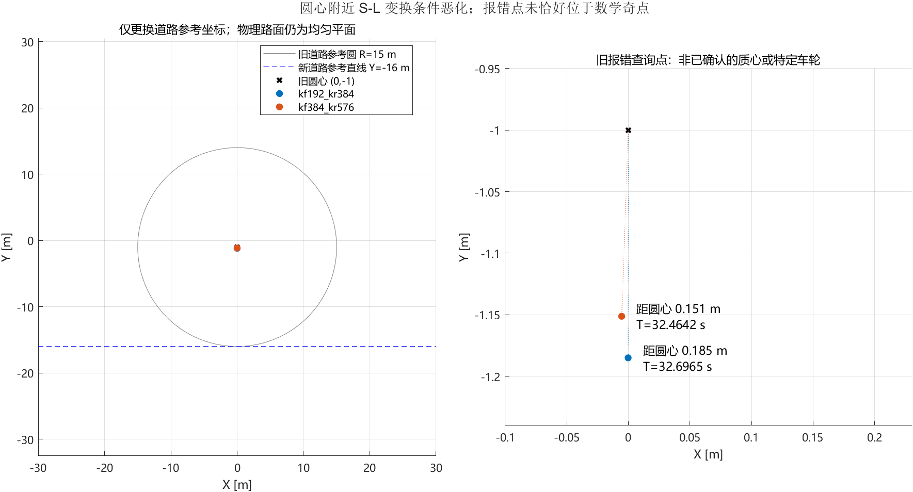
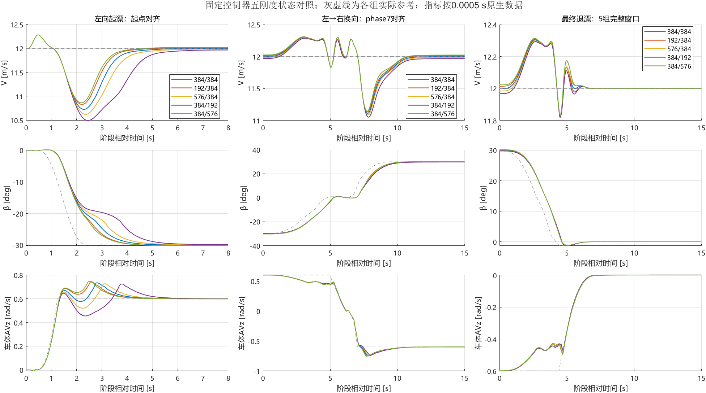
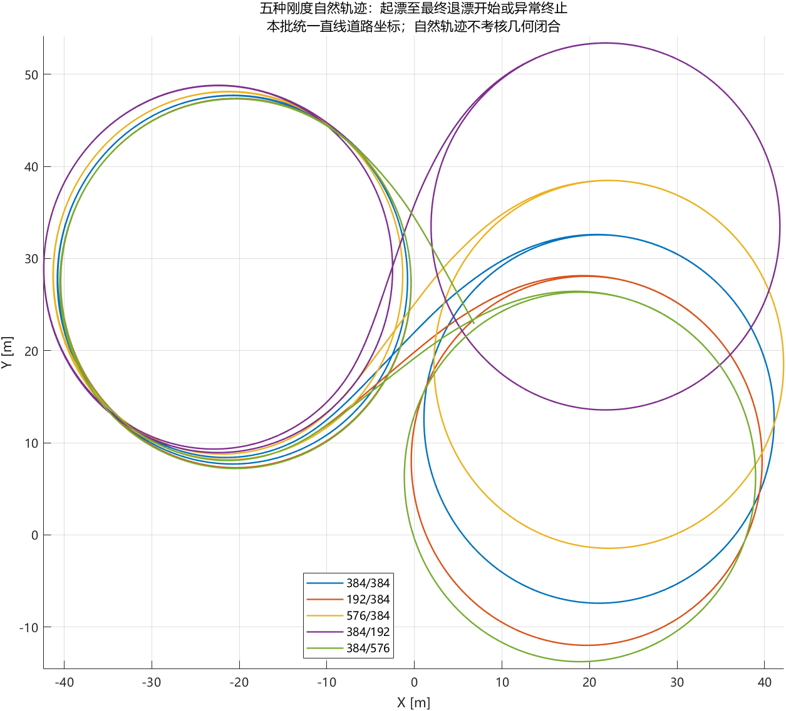
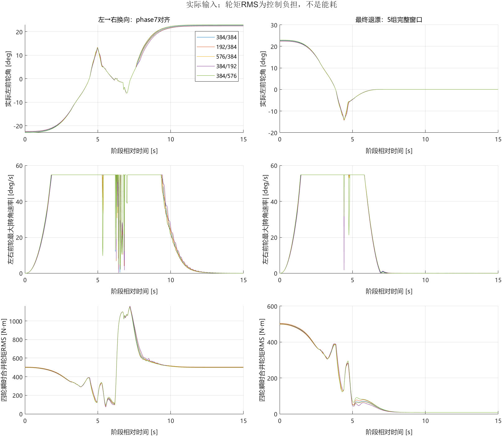
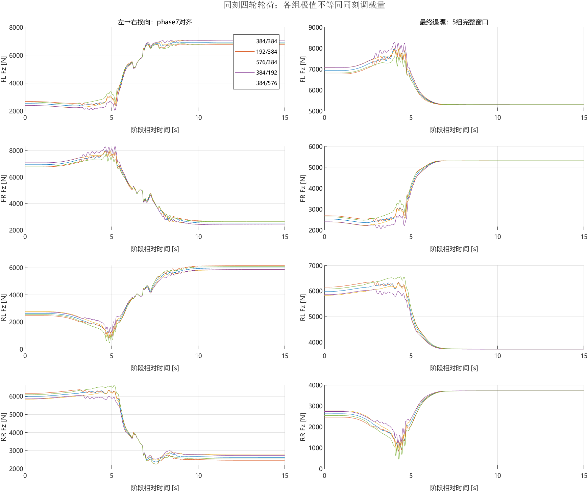
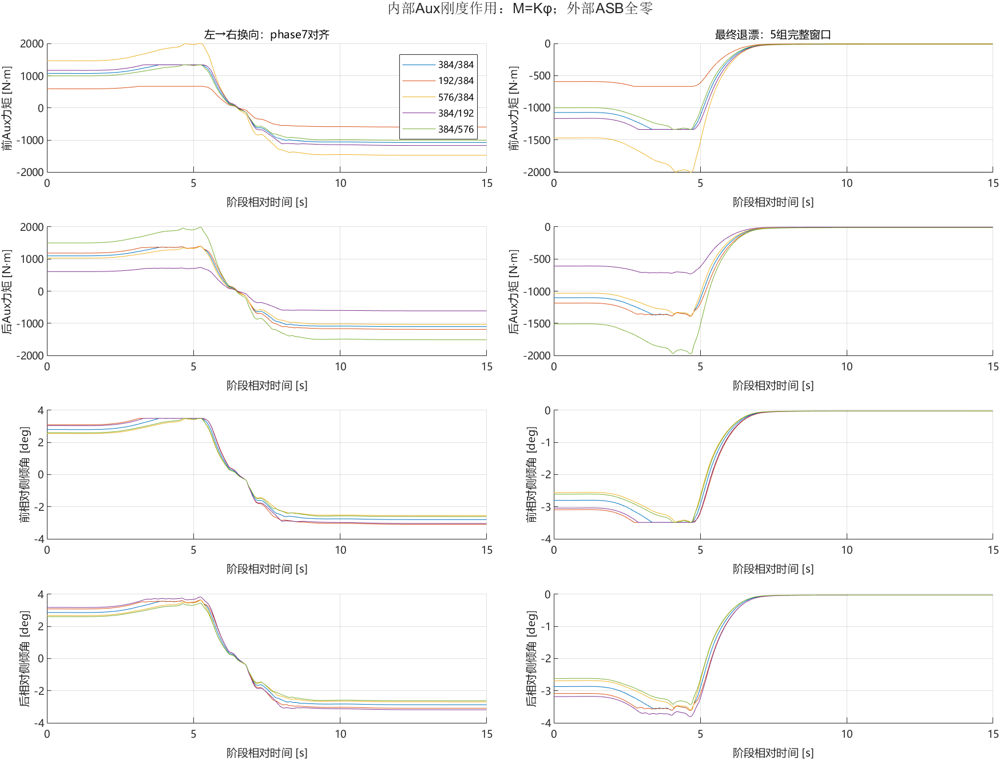
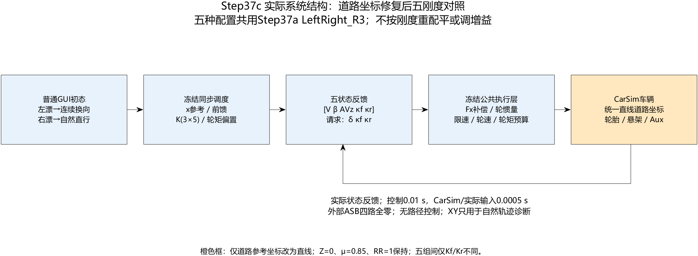

# V0.5：±30°左右连续漂移与五种辅助侧倾刚度对照


## 版本目的与V0.4的关系

V0.4建立了单向−30°状态漂移、固定辅助刚度对照及独立主动起漂脉冲证据。V0.5进一步检验：在一套冻结控制策略下，车辆能否从左漂连续切换到右漂，再恢复直行；五种固定辅助刚度的作用方向和代价是否随阶段变化。

本版展示自然形成的左右双环轨迹，**“八字漂移”在这里指左右漂移及换向的状态任务，不是给定交叉点、位置、航向和闭合误差的八字路径跟踪。**不把V0.4主动脉冲结果移植为本版主动ASB结论。五组仅改变内部Auxiliary Roll线性系数，外部四路悬架附加力全程为零。

|比较项|V0.4原发布与补充|V0.5|
|---|---|---|
|运动任务|单向左漂与恢复|左漂、连续换向、右漂与恢复|
|路径|无路径反馈|无路径反馈，轨迹只作诊断|
|退出|原发布分段退出；后补同步连续节点退出|右漂后同步连续节点退出，单一进度|
|刚度对照|五种固定内部系数|相同五种系数，一套冻结双向控制器|
|主动试验|独立Step36a起漂±250 N·m补充|本版不施加主动脉冲|
|证据来源|Step35f/g、35m/n及36a|Step37a方法、37b异常历史、37c完整五组|

不能直接用两版最终恢复时间相减评价“升级收益”：V0.5的退出方向和此前运动历史不同。

## 控制如何工作，比较是否公平

主链为阶段/状态参考调度→3×5五状态反馈→前轮转角及前后滑移请求→公共执行层→CarSim。反馈状态为[V,β,AVz,κf,κr]，V=hypot(Vx,Vy)。Roll/AVx仍在物理模型与既有判断中，不恢复七状态反馈。

左漂目标V=12 m/s、β=−30°、车体AVz=+0.5989797412715093 rad/s；右漂β=+30°、AVz=−0.5989862394182109 rad/s。AVz为车体系角速度，不直接等同明显侧倾下的航向角变化率。右端点使用已核查配平，右增益沿用镜像构造的冻结R3；不能称所有过渡节点均重新独立辨识。

起漂采用2.5 s连续调度；左、右各固定维持10 s。换向使用29/3 s的15节点同步连续调度，最后退出使用43/6 s同步连续节点调度。状态参考、三路前馈、K和四轮偏置按同一进度推进，内部节点不逐个重新安排首尾减速；相邻节点线性插值数值连续，但导数可跳变。**没有采用旧C方案的独立K时钟，也没有把换向看成动力学可逆过程。**

K数值和调度规则在五组之间相同，初始化不按刚度重配平或调增益。实际转角、转角速度与四轮轮矩仍随反馈变化。因此比较的是“同一控制策略面对不同配置的任务表现”，不是八路实际输入完全相同下的纯车辆辨识。

控制周期0.01 s，车辆/实际输入与原生记录0.0005 s，接口12输入/76输出。保留实际Fx补偿、轮惯量、转向/滑移限速、轮速预算与±3000 N·m轮矩预算；不恢复后轴正向滑移0.4上限。普通GUI初态出发，不恢复漂移快照、不人为重置换向状态。

## 如何判定通过

- 左右起漂分别同时满足速度误差≤0.2 m/s、β误差≤2°、AVz误差≤0.03 rad/s及正确转向符号，连续600个原生点。
- 两段首次固定10 s维持各用20,000点计算RMSE，门槛为0.2 m/s、2°、0.03 rad/s；不重新挑选更好窗口。轮矩保护占比≤5%、最长连续≤0.2 s，轮荷须为正，并保留原硬约束。
- 恢复要求V=12±0.2 m/s、|β|≤1°、|AVz|≤0.02 rad/s，连续2,000点，从实际退出开始独立搜索。
- 表中耗时取持续合格段起点，确认时刻另存；600/2,000点名义0.30/1.00 s，首末点跨度为0.2995/0.9995 s。转向贴限、滑移裁剪、止挡和表外推另列，不能由警告条数判机械安全。
- 自然半径和轨迹不进入本轮状态任务PASS。单次确定性通过不代表扰动鲁棒性或实车能力。

## 结论先行

本批完成五次60 s任务，5组通过原状态任务验收。上批两组中断不能作为刚度导致失控的证据。它们在同一控制器、同一物理平面下，换用直线道路参考坐标后补齐了右漂维持和退漂记录。

关键证据不只是“这次跑通”：五组各自与Step37b旧记录的全部56个数值通道，在旧记录可用时间内逐位一致。旧三组完整60 s响应复现；旧两组中断前的响应也复现，随后才新增原来缺失的时段。未更改增益、参考、输入限速或验收门槛。

这是**道路坐标表示问题的隔离修复**。几何分析支持旧圆心附近坐标变换条件恶化；没有读取CarSim内部迭代过程，不能声称已定位其具体迭代代码缺陷，也不能把报错查询点冒称质心或某个车轮。

## 1. 原因：物理路面与道路参考线不是一回事

旧Echo显示：道路参考线起点(0,−16)、初始方向0°、半径15 m、完整360°圆，圆心为(0,−1)。界面历史标题“100 m”“16 m”不是实际采用的半径。

与此同时，真实路面为均匀平面：高度0 m、μ=0.85、滚阻表面系数1，无附加高程层。内置驾驶员OPT_DM=0，OPT_INIT_PATH=0，控制器不使用XY/道路投影推进任务。CarSim仍要进行道路坐标查询，因此“控制器无路径反馈”不等于“CarSim不需要道路坐标”。

圆坐标可写为：

```text
X = (15−L) sin(S/15)
Y = −1−(15−L) cos(S/15)
Jacobian determinant = 1−L/15
```

L接近15 m时，沿路坐标对位置变化十分敏感；在圆心处S不唯一。旧报错点并未恰好落在圆心，而是距圆心约15—19 cm：

| 旧组别 | 报错时间/s | 距圆心/m | 局部几何敏感度R/d |
| --- | --- | --- | --- |
| kf192_kr384 | 32.6965 | 0.185040 | 81.06 |
| kf384_kr576 | 32.4642 | 0.151355 | 99.10 |

原生最后样本与内部错误时刻可能相差一个求解子步：后576组原生结束32.4640 s，日志错误32.4642 s。上述X/Y来自错误日志中的查询点，身份未暴露。报告不把它与质心轨迹强行重合。

本机CarSim 2020《Paths and Road Surfaces》3—6页说明S/L用于路面查询、XY→SL存在迭代及多解问题，并给出直线坐标的使用方式。在线官方概述亦说明路面高度、摩擦与滚阻基于道路S/L坐标：[Paths and Roads](https://www.carsim.com/products/supporting/paths_roads/index.php)。本轮版本依据以本机手册及实际Echo为准。



## 2. 改了什么、怎样证明比较条件相同

在独立Step37c sim/par内，将OPT_PATH_LOOP从1改为0、SEGMENT_TYPE从3改为0，半径/圆心角两行替换为SEGMENT_LENGTH 2000。保留参考线起点(0,−16)和朝向0°，因此新坐标为S=X、L=Y+16，不存在原圆心奇异性。

高度、μ、滚阻、±2000 m横向边界参数、初态、车辆、轮胎、悬架和求解周期保持。坐标改变后边界在全局平面中的形状也改变，本轮轨迹未接近这些边界；等价性限定在本任务实际经过区域。直线是路面的坐标参考，**不是要求车辆沿直线走**。自然左右圆漂目标及其约20 m半径没有改变。正式sim/par和GUI数据库未写回；旧标题仍是来源标签，真实配置由Echo核验。

五组间只保留两项Aux系数差异；同组新旧配置只有上述道路坐标白名单和运行输出路径差异。控制模型、初始化、核心函数和LeftRight_R3 profile与Step37b字节一致。准备阶段验证五组控制数值一致，并以XY扰动检查请求/阶段不受路径信号影响。

实际四轮地面高度、X/Y坡度及MuX/MuY也已逐组核对：高度/坡度在数值精度内为零，纵横向附着在VSB浮点精度内为0.85。该证据保持原VSB的0.01 s分辨率，不冒称0.0005 s原生地面查询记录；完整结果见[道路配置与地面输出核验](../../experiments/v0.5/evidence/batch/final_road_validation.json)。

先完成384/384回归，再逐组运行和审核，没有带着未解释差异继续：

| 配置 | 旧有效终点/s | 新终点/s | 逐位一致通道数 | 共同段逐位一致 |
| --- | --- | --- | --- | --- |
| 384/384 | 60.0000 | 60.0000 | 56 | 是 |
| 192/384 | 32.6965 | 60.0000 | 56 | 是 |
| 576/384 | 60.0000 | 60.0000 | 56 | 是 |
| 384/192 | 60.0000 | 60.0000 | 56 | 是 |
| 384/576 | 32.4640 | 60.0000 | 56 | 是 |

此证据支持：本次道路坐标修改没有改变已观察到的车辆状态、实际8路输入、轮胎/悬架和控制响应。旧两组终点后的响应是新仿真获得，未拼接、补点或复原快照。[旧FAIL日志](../../experiments/v0.5/evidence/previous_road_failures)保留为“道路求解中断”，本批独立评价，不覆盖历史结果。

## 3. 补齐后的五组结果

统一任务：普通初态→左−30°→首次10 s维持→29/3 s连续换向→右+30°→首次10 s维持→43/6 s同步退漂→自然直行。V=12 m/s，五状态R3冻结，外部ASB为零、无路径跟踪。

事件使用600个原生样本起漂、20,000个原生样本固定维持、2,000个原生样本恢复；所有门槛继承Step37a/37b。表中时间取持续合格段起点相对于对应阶段起点；确认时刻另存details.json。半径只是诊断，不加入本轮状态任务PASS。

| 前/后Aux刚度 | 本批结果 | 左起漂/s | 换向至右漂/s | 最终恢复/s | 右维持β RMSE/° | 右自然半径/m |
| --- | --- | --- | --- | --- | --- | --- |
| 384/384 | PASS | 3.7625 | 9.6060 | 6.4930 | 0.0741 | 19.9984 |
| 192/384 | PASS | 3.5420 | 9.5760 | 6.4760 | 0.1667 | 20.0367 |
| 576/384 | PASS | 4.0575 | 9.6265 | 6.5055 | 0.2112 | 19.9670 |
| 384/192 | PASS | 4.7650 | 9.7510 | 6.4630 | 0.2488 | 19.9220 |
| 384/576 | PASS | 3.4695 | 9.5320 | 6.5130 | 0.1527 | 20.0599 |

最终恢复最快为384/192，6.4630 s；最慢为384/576，6.5130 s，相差50.0 ms。这是本次确定性任务的差异，不是统计显著性、鲁棒性或绝对能力边界。





## 4. 差异和代价分别看

| 配置 | 换向最低V/m·s⁻¹ | 换向最低Fz/N | 换向轮矩RMS/N·m | 换向轮矩峰/N·m | 退漂最低V/m·s⁻¹ | 退漂最低Fz/N |
| --- | --- | --- | --- | --- | --- | --- |
| 384/384 | 11.1109 | 799.41 | 537.37 | 1552.55 | 11.8270 | 861.43 |
| 192/384 | 11.1336 | 825.73 | 537.85 | 1540.51 | 11.8284 | 829.88 |
| 576/384 | 11.0854 | 859.40 | 537.55 | 1564.78 | 11.8256 | 880.23 |
| 384/192 | 11.0527 | 1188.32 | 541.12 | 1583.82 | 11.8191 | 1208.92 |
| 384/576 | 11.1468 | 452.91 | 535.50 | 1527.76 | 11.8312 | 450.39 |

轮矩RMS按固定窗口四轮平方均值开方计算，不是能耗；各组最低轮荷不是同刻调载量。完整起漂8 s、换向15 s、最终退漂15 s窗口均使用原生0.0005 s数据；控制裁剪按0.01 s诊断。

本批起漂/换向时序复现旧结果：384/576更早进入左右漂移，384/192较慢；但后576换向最低轮荷更低、反向横摆幅值更大。后192的轮荷余量较大、最终恢复较快。不能据此选出各阶段全部指标最优的配置。

前后分配还需与总辅助系数区分：192/384与384/192的总和均为576；576/384与384/576均为960。在这两对同总系数对照中，偏后分配均更早进入左右漂移，而偏前分配的最终恢复稍快。该方向一致性只覆盖本批任务。384/384总和为768，跨三种总和比较同时混入总系数和分配变化，不能把五组整体排序全部归因于分配比例。

同刻五组β极差峰值：起漂7.802063°，换向1.904295°，最终退漂0.482763°。各窗口及调度不同，不能把这些比值当作车辆固有灵敏度。β曲线分离不是通过条件。





四轮实际滑移、轮胎Fx/Fy及请求—预算后目标分别见wheel_slip.png、tire_forces.png和request_budget.png。力维持原轮胎坐标，不能直接将左右Fy相加冒充车体系轴合力。

## 5. 模型适用范围与研究边界

本轮修复的是道路坐标，不是悬架外推。后簧、几何和轮胎表端警告继续保留；原始查询、超域幅度/时长、止挡及约束审计随本批记录保存，未扩表。正轮荷和任务PASS不等同实车机械安全。模型仍限于当前CarSim参数和既定外推。

- `kf384_kr384`：RL查询峰值90.352 mm，超上界40.352 mm、累计19.5265 s；RR查询峰值90.374 mm，超上界40.374 mm、累计19.9650 s。
- `kf192_kr384`：RL查询峰值90.372 mm，超上界40.372 mm、累计19.6585 s；RR查询峰值90.404 mm，超上界40.404 mm、累计19.8005 s。
- `kf576_kr384`：RL查询峰值90.340 mm，超上界40.340 mm、累计19.2385 s；RR查询峰值90.362 mm，超上界40.362 mm、累计19.8485 s。
- `kf384_kr192`：RL查询峰值90.377 mm，超上界40.377 mm、累计19.9280 s；RR查询峰值90.373 mm，超上界40.373 mm、累计21.0710 s。
- `kf384_kr576`：RL查询峰值90.335 mm，超上界40.335 mm、累计19.0425 s；RR查询峰值90.362 mm，超上界40.362 mm、累计19.5200 s。

这里研究的是固定内部Aux刚度，Kaux也不是整轴总侧倾刚度。外部主动ASB未介入，不将结果称为主动ASB控制收益。自然左右双环未规定交叉点和闭合位置，不能称指定几何八字路径跟踪通过。



## 6. 保存与复核

每组一份无损56通道原生raw_numeric.mat及必要CarSim证据；历史只引用，旧短记录未删除。主表summary.csv，详细窗口/事件details.json，同刻极差separation.json；独立道路身份和源文件保护见audit/final_road_validation.json。

- `internal/review_case.py <case>`：只读原生数据复算验收、执行公式与同组新旧回归。
- `internal/compare_cases.py`：只读五组生成总表和可重建绘图缓存。
- MATLAB `render_comparison; render_road_diagnosis`：只绘图，不启动车辆。
- `internal/run_state_only_case.m`与`run_remaining.m`：已完成的车辆运行入口，不为看图再次调用。
- 唯一初始化仍保留`model/a001_step37a_initialize.m`原名与原字节，避免改动回调。报告结构图与本批真实执行配置配套。

本批车辆实验完成后停止。V0.5仅整理已有结果发布，没有新增车辆仿真、控制器整定或主动ASB。发布入口见[模型与证据说明](../../experiments/v0.5/README.md)，[配置与来源映射](../../experiments/v0.5/source/publication_sources.json)。
